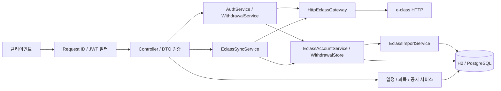

# 캠퍼스 온 API (Spring Boot 백엔드)

현재 구현은 **서울과기대 e-class 학번·비밀번호 로그인 → 앱 계정 자동 생성 → 과목·할 일 수집 → 일정/ICS 조회** 흐름입니다. 별도 이메일 회원가입은 없습니다. 사용자가 지정한 [Planary](https://github.com/yoobinkim541/plannary_smart_planner)의 로그인 폼·쿠키·페이지 파싱 방식을 Java로 옮겼습니다.

- **인증:** 학교 인증 성공 후 Access/Refresh JWT 발급. 로그아웃 시 `users.token_version`을 원자적으로 증가시켜 두 토큰을 즉시 무효화합니다.
- **학내 연동:** 로그인 직후 비동기 수집, 기본 5분 간격 재수집, 수동 동기화·연결 해제·상태 조회.
- **일정:** 개인 일정 CRUD, 수집 일정의 완료 표시, 과목명·원문 링크·명시된 소요 시간, D-day, 날짜 미정 목록, 사용자별 ICS.
- **학교 소식:** 내 학교 공지 목록·상세. 본문과 대상 학과의 저장·조회 계약 포함.

기존 이메일 인증 구현은 이번 사용자 지시로 대체했습니다. 제공된 `STack DB.sql`의 관련 구조를 PostgreSQL에 반영하되 기존 F1·F3·F6 기능과 앱 전용 테이블은 유지하는 합의입니다. 전체 LMS 행정 기능, 공지 크롤러, AI, Google 로그인은 구현하지 않습니다. ERD 대응 범위는 [인계 문서](docs/erd-handoff.md)에 있습니다.

## 실행 방법

작업 디렉터리는 `backend/`입니다. Java 21, Spring Boot 3.5.16, Gradle 8.14.6입니다.

| 목적 | 명령 | 비고 |
|---|---|---|
| 로컬 실행 | `gradlew.bat bootRun` | 기본 `local`, H2 메모리 DB, Flyway V1~V6와 예시 공지 4건 |
| 테스트 | `gradlew.bat test` | `test` 프로필 고정, 외부 학교 대신 테스트 전용 경계/로컬 HTTP 서버 사용 |
| 패키징 | `gradlew.bat bootJar` | `build/libs/campus-on-api-0.1.0.jar` |
| Docker | `docker compose up --build` | PostgreSQL 17 + `prod` 앱. 아래 두 비밀키를 먼저 설정 |

`test`와 `bootRun` 태스크는 상속된 `SPRING_*` 환경변수를 제거합니다. 외부 DB 설정이 남은 셸에서의 오접속 방지입니다. 운영 배포는 Docker 또는 명시적 `prod` 설정으로 실행합니다.

Windows 한글 경로에서는 Gradle 워커 인수 파일과 JVM의 네이티브 인코딩이 달라 테스트 클래스 로딩이 실패할 수 있습니다. 이번 검증은 임시 ASCII 드라이브 경로에서 Gradle을 실행했습니다. 앱 스모크는 실제 작업 경로에서 실행했습니다. 임시 경로와 검증 프로세스는 종료 후 제거했습니다.

## 프로필과 설정

| 프로필 | DB | 비밀키 | 용도 |
|---|---|---|---|
| `local` | H2 메모리 `campus` + 예시 공지 | 로컬 전용 값 | 개발 |
| `test` | H2 메모리 `testdb`, 예시 공지 없음 | 테스트 전용 값 | 자동 동기화 비활성 |
| `prod` | `DB_URL`, `DB_USERNAME`, `DB_PASSWORD` | `JWT_SECRET`, `ECLASS_ENCRYPTION_KEY` 필수 | 배포 |

| 설정 | 의미 |
|---|---|
| `JWT_SECRET` | JWT HS256 서명 키, 32바이트 이상 |
| `ECLASS_ENCRYPTION_KEY` | e-class 쿠키·선택 저장 비밀번호용 독립 키, UTF-8 32바이트 이상. JWT 키 대체/기본값 없음 |
| `PUBLIC_BASE_URL` | ICS 구독 주소의 공개 origin |
| `campus.eclass.base-url` | 기본 `https://eclass.seoultech.ac.kr`. 로컬 HTTP는 loopback 픽스처만 허용 |
| `campus.eclass.request-timeout` | 개별 요청 제한, 기본 `PT10S` |
| `campus.eclass.sync-delay` | 재수집 간격, 기본 `PT5M` |
| `campus.eclass.sync-enabled` | 로그인 후/주기적 수집 활성 여부. 수동 동기화 API는 별도 |
| `campus.eclass.failure-backoff` | 일시 실패(`FAILED`) 연결을 자동 수집이 다시 고르기까지 기다리는 시간, 기본 `PT30M`. `REAUTH_REQUIRED` 연결은 자동 수집하지 않음 |
| `campus.eclass.manual-sync-cooldown` | 마지막 시도(로그인 포함, `connection.updated_at`) 이후 수동 동기화 허용 간격, 기본 `PT1M`. 위반 시 429 + `Retry-After`(초). test 프로필은 `PT0S` |
| `campus.auth.throttle.max-failures-per-student` / `max-failures-per-client` / `window` | 학교 비밀번호 실패 제한. 기본 학번당 5회, 클라이언트(신뢰 프록시 리졸버 주소)당 20회, 고정 창 `PT15M`. 학교에 응답을 기다리는 진행 중 시도도 예산에 넣어(완료 실패 + 진행 중 < 한도일 때만 입장) 동시 요청으로 한도를 넘지 못합니다. 초과 시 학교에 요청하지 않고 429. 진행 중 시도 때문에만 막히면 `Retry-After` 1초, 그 밖에는 창 종료까지. DB 공유 카운터·만료 예약 |
| `campus.auth.throttle.reservation-lease` | 진행 중 비밀번호 시도 예약 만료, 기본 `PT15S`. 실제 적용은 학교 인증 전체 제한 + 5초 이상. 다음 예약·완료에서 만료 행 정리 |
| `campus.withdrawal.offline-recent-auth` | 학교 통신 장애(`ECLASS_UNAVAILABLE`)일 때만 access JWT의 실제 학교 인증 시각 `auth_time`이 이 기간(기본 `PT10M`) 이내면 탈퇴. refresh는 시각을 유지. 없거나 오래되면 503 `WITHDRAWAL_REAUTH_UNAVAILABLE`, 틀린 비밀번호는 401 `INVALID_PASSWORD` |
| `campus.eclass.sync-lease` | 서버 간 동기화 선점, 기본 `PT5M`. 실제 적용은 수집 2회 전체 상한(각 2분) + 학교 인증 제한 + 5초 이상. 저장 비밀번호 재인증 claim은 인증 제한 + 5초. 연결 교체·삭제는 커넥션 없이 최대 이 시간만큼 재시도하며, 계속 활성 상태면 409 |
| `campus.security.trusted-proxies` | 신뢰 프록시 CIDR을 쉼표로 구분, 기본 빈 문자열(전달 헤더 무시) |


클라이언트 IP는 `ClientAddressResolver` 하나로 결정합니다. 기본은 소켓 peer이며 `campus.security.trusted-proxies`(쉼표로 구분한 IPv4/IPv6 CIDR, 기본 빈 문자열)에 peer가 포함될 때만 XFF를 오른쪽부터 읽어 첫 비신뢰 주소를 선택합니다. 체인에 잘못된 주소가 하나라도 있으면 peer로 돌아갑니다. `server.forward-headers-strategy: NONE`을 유지합니다. 학번은 NFKC → `strip()` 후 내부 공백·제어 문자·64자 초과를 400으로 거절합니다. 학교 profile의 학번도 같은 규칙으로 비교·저장하며 throttle 키만 소문자로 묶습니다. 기존 ASCII 학번·선행 0은 그대로입니다. 과거에 저장한 비정규 Unicode 학번은 자동 이관하지 않으므로 운영 데이터 확인이 필요합니다. 학교 자체 잠금 기준은 미검증입니다.

로그인 요청:

```json
{"studentId":"20261234","password":"<학교 비밀번호>","rememberCredentials":false}
```

비밀번호는 기본적으로 저장하지 않습니다. 세션 쿠키는 AES-256-GCM으로 암호화해 저장합니다. `rememberCredentials=true`를 명시한 경우에만 비밀번호도 같은 독립 키로 암호화해 저장하여 세션 만료 시 재인증합니다. 다음 로그인에서 false로 보내면 이전 저장 비밀번호를 지웁니다. false인 연결은 세션 만료 시 재로그인이 필요합니다. `DELETE /api/eclass/connection`은 저장 쿠키·비밀번호를 삭제하고 이미 수집한 일정은 보존합니다.

로그인 성공은 302만으로 판정하지 않습니다. 숨은 필드와 bootstrap 쿠키를 전달하고, 같은 origin만 따라가며, 최종 페이지에서 로그인 폼 부재와 인증된 DOM 표식을 확인합니다. 응답·쿠키·요청 수에 상한이 있고 초과하면 실패합니다.

## API

인증이 필요한 경로는 `Authorization: Bearer <accessToken>`을 사용합니다.

| 메서드 | 경로 | 인증 | 응답/계약 |
|---|---|---|---|
| GET | `/api/schools` | 불필요 | 학교 목록. 현재 로그인 대상은 서울과기대 |
| POST | `/api/auth/login` | 불필요 | e-class 인증·자동 등록, JWT 쌍. 학교 인증 실패 401 `INVALID_CREDENTIALS`, 비활성 계정 403 `FORBIDDEN`, 실패 한도 초과 429 `TOO_MANY_REQUESTS` + `Retry-After` |
| POST | `/api/auth/refresh` | refresh 본문 | `{"refreshToken":"..."}`, 새 JWT 쌍 |
| POST | `/api/auth/logout` | 필요 | 204, 모든 기기의 기존 access·refresh 무효. 같은 트랜잭션에서 학교 연결(쿠키·저장 비밀번호)도 삭제해 백그라운드 수집이 멈춤. 다음 로그인에서 다시 생성 |
| GET | `/api/me` | 필요 | `id, studentId, name, department, grade, schoolId, schoolName`. 이메일 없음 |
| PATCH | `/api/me` | 필요 | 학과(최대 200자)·학년(1~6)만 수정. 생략=유지, null=비우기 |
| DELETE | `/api/me` | 필요 | 현재 학교 비밀번호 확인 후 앱 계정·일정·ICS·수강 소속·연결 비밀 삭제, 204. 학번당 실패 한도 초과 시 429 |
| GET | `/api/eclass/connection` | 필요 | `state, lastSyncedAt, lastErrorCode, credentialsRemembered`. 비밀값 없음 |
| POST | `/api/eclass/sync` | 필요 | 실제 동기화 후 연결 상태 반환. 같은 회원 동기화 진행 중이면 409 `ECLASS_SYNC_IN_PROGRESS`, 쿨다운 중이면 429 + `Retry-After` |
| DELETE | `/api/eclass/connection` | 필요 | 204, 연결 비밀 삭제 |
| GET | `/api/courses` | 필요 | 내 수강 과목: `id, externalId, name, courseType, status` |
| GET | `/api/events?from=YYYY-MM-DD&to=YYYY-MM-DD` | 필요 | 마감일 기준, 양 끝 포함 최대 62일, 마감·id 오름차순 |
| GET | `/api/events/undated` | 필요 | 마감 미정 수집 일정 |
| POST | `/api/events` | 필요 | 개인 일정 생성, 201 |
| PUT | `/api/events/{id}` | 필요 | 개인 일정 전체 수정 |
| PATCH | `/api/events/{id}/done` | 필요 | 개인·수집 일정 완료 상태 수정 |
| DELETE | `/api/events/{id}` | 필요 | 개인 일정 삭제, 204 |
| POST | `/api/calendar-feed` | 필요 | 구독 URL 발급/회전. 이전 URL은 404 |
| GET | `/api/calendar-feed` | 필요 | 현재 URL, 없으면 404 |
| GET | `/ics/{token}.ics` | 토큰 자체 | `text/calendar`, `Cache-Control: no-store` |
| GET | `/api/notices?category=&page=0&size=20` | 필요 | `items, page, size, totalElements, hasNext`. 최신 게시·id 내림차순 |
| GET | `/api/notices/{id}` | 필요 | 상세, `body`·`targetDepartments` 포함 |
| GET | `/actuator/health` | 불필요 | 상태 |

`/api/auth/signup`은 제거했습니다. 학교 인증 실패는 401 `INVALID_CREDENTIALS`, 세션 만료는 401 `ECLASS_REAUTH_REQUIRED`, 학교 응답/연결 실패는 502 `ECLASS_UNAVAILABLE`입니다. 연결 상태는 `PENDING / READY / FAILED / REAUTH_REQUIRED / DISCONNECTED`입니다.

백그라운드 수집 규칙: 자동 수집은 `ACTIVE` 회원의 `PENDING`/`READY` 연결을 `sync-delay` 뒤에, `FAILED` 연결은 `failure-backoff` 뒤에만 고르고 `REAUTH_REQUIRED`는 고르지 않습니다. 이미 진행 중인 회원은 건너뜁니다. 저장 비밀번호를 학교가 거절하거나 저장 비밀값을 복호화할 수 없으면 저장 비밀번호를 지우고 `REAUTH_REQUIRED`로 바꿔 다시 시도하지 않습니다(거절 시 `lastErrorCode=INVALID_CREDENTIALS`). 재인증 결과는 학번 일치와 비어 있지 않은 쿠키를 확인하고, 아니면 `ECLASS_UNAVAILABLE`입니다.

연결 세대: 로그인할 때마다 `eclass_connections.connection_generation`(V5)이 새 UUID로 바뀝니다. 동기화는 시작할 때 읽은 세대가 연결 행 락(학교 → 사용자 → 연결 순서) 아래에서 그대로일 때만 성공·실패·복호화 실패를 반영하고, 저장 비밀번호로 재인증하기 전에는 세대와 sync lease 소유자를 조건부 UPDATE로 원자적으로 확인하고 claim을 선점합니다. claim이 살아 있는 동안 연결 교체·삭제는 커밋되지 않습니다. 그래서 로그아웃→재로그인 사이에 끝난 옛 작업은 새 연결을 덮지 않고 버려집니다. HTTP 중에는 DB 트랜잭션·커넥션을 보유하지 않습니다. 자세한 기한과 대기는 [ADR-0009](docs/adr/0009-distributed-auth-sync.md)를 참고하세요. 동기화 실패 로그는 memberId와 ErrorCode만 남깁니다: `ECLASS_REAUTH_REQUIRED`/`UNAUTHORIZED`는 info, 그 밖(네트워크 오류의 `ECLASS_UNAVAILABLE`, `INVALID_CREDENTIALS` 등)은 warn, 버린 옛 결과는 info입니다.

탈퇴 확인 비밀번호가 틀리면 401 `INVALID_PASSWORD`이고 아무것도 삭제하지 않습니다. 성공하면 이전 access·refresh는 401, 이전 ICS는 404입니다. 학교 계정 자체는 삭제하지 않으므로 같은 학번으로 다시 인증하면 **새 앱 id**가 생성됩니다. 예전 토큰·일정은 복구되지 않습니다. 공유 학교·과목·공지는 보존하며 외부 캘린더에 이미 복사된 사본은 지우지 못합니다.

### 데이터 의미

- 수집 일정에는 `courseId, courseName, durationSeconds, sourceUrl, dateOnly`가 추가됩니다. 원문에 없는 값은 null입니다. 개인 일정 제목은 80자, 수집 제목/DB는 200자입니다.
- `dueAt`은 KST offset 날짜·시각입니다. `dDay`는 KST 오늘과 마감 날짜의 차이이며 미래 양수/오늘 0/과거 음수입니다.
- 원문에 날짜만 있으면 `dateOnly=true`, `dueAt`은 그 날짜의 KST 00:00 기준값입니다. 실제 자정 마감을 주장하지 않으며 ICS는 종일(`VALUE=DATE`)입니다. 날짜조차 없으면 `dueAt/dDay=null`; 기간 캘린더와 ICS에서는 제외하고 `/undated`로 제공합니다.
- 같은 외부 식별자의 재수집은 기존 일정 id와 사용자가 표시한 완료 상태를 유지합니다. 부분 수집 결과에 안 보인다는 이유로 기존 항목을 삭제하지 않습니다. 원문에 항목 id가 없으면 제목 기반 식별을 사용하므로 제목 변경을 같은 항목으로 연결한다고 보장하지 않습니다.
- 사용자 이름·학과·학년을 로그인 원문에서 신뢰성 있게 추출하지 못하면 임의 생성하지 않습니다. 학과·학년은 프로필 PATCH로 보완할 수 있습니다.
- 공지 `body`는 문단·목록 표시를 보존하는 plain text이며 원문 HTML을 전달하지 않습니다. `targetDepartments=[]`는 학과 제한 없음입니다. 크롤러/태깅 생성은 범위 밖이므로 값이 공급되지 않은 기존 공지의 본문은 null입니다.

남의 일정과 다른 학교 공지는 403 대신 404입니다. ICS는 JWT와 별도 자격이므로 로그아웃만으로 끊기지 않으며 재발급·탈퇴로 폐기합니다. 활성(`ACTIVE`)이 아닌 계정(V3에서 정지한 옛 이메일 계정)의 피드는 404 `CALENDAR_FEED_NOT_FOUND`입니다.

## 오류·로그

오류는 ProblemDetail(`application/problem+json`)이며 `code`, `requestId`, `timestamp`가 붙습니다. 실제 로컬 HTTP 스모크의 잘못된 학교 비밀번호 응답:

```json
{
  "type": "about:blank",
  "title": "Unauthorized",
  "status": 401,
  "detail": "학번 또는 e-class 비밀번호가 올바르지 않습니다.",
  "instance": "/api/auth/login",
  "code": "INVALID_CREDENTIALS",
  "requestId": "1b6a0b1a-d435-433e-96f0-60f439de60c2",
  "timestamp": "2026-11-07T12:04:51.276655700Z"
}
```

401 보안 핸들러는 `WWW-Authenticate: Bearer`, 405는 `Allow`, 415는 `Accept`를 제공합니다. 요청 본문·Authorization·학교 쿠키는 접근 로그에 기록하지 않으며 ICS 토큰은 로그와 오류 `instance`에서 `/ics/***.ics`로 가립니다.

## 아키텍처



HTTP 인증·수집은 DB 트랜잭션 밖에서 수행합니다. 저장·삭제만 짧은 서비스 트랜잭션으로 묶고, OSIV는 끄며 DTO 변환은 조회 트랜잭션 안에서 수행합니다. 패키지·트랜잭션 결정은 ADR을 참고하세요.

## 스터디에서 프로젝트로

velog "Spring Study" 시리즈(@snowmile1224, 33편)에서 배운 것과, 그때 스스로 남긴 부채·약점이 이 프로젝트 어디에 들어갔는지 정리했습니다. 상환 내역은 [부채 원장 (A)](docs/tech-debt-ledger.md)에 테스트 이름까지 적었습니다.

| Day·글 | 배운 것 | 이 프로젝트의 적용 위치 | 달라진 점 |
|---|---|---|---|
| [Day 3][d3], [Day 7][d7] | `@Valid`, `@RestControllerAdvice`, Optional→예외→404 | `global/error/ErrorCode.java`, `ApiProblems.java`, `GlobalExceptionHandler.java` · [ADR-0006](docs/adr/0006-problem-detail-errors.md) | 오류 본문 3종(field Map, `{"errors":[]}`, `{"error":""}`)을 ProblemDetail 하나로 통일. `code`·`requestId` 추가, 같은 필드의 위반도 덮어쓰지 않고 모두 `errors`에 담음 |
| [Day 27~28][d27] | 401/403 커스텀 핸들러 | `global/security/ProblemAuthenticationEntryPoint.java`, `ProblemAccessDeniedHandler.java` | 문자열 이어 붙이기 대신 `ObjectMapper`로 ProblemDetail 직렬화. 400~500 전부 같은 형식 |
| [Day 4][d4], [Day 5][d5], [Day 10][d10] | Service/Repository 분리, 생성자 주입, 어댑터 교체 | 기능별 패키지, 모든 빈 생성자 주입 · [ADR-0001](docs/adr/0001-feature-first-packages.md), [ADR-0002](docs/adr/0002-spring-data-as-port.md) | 계층 우선 → 기능 우선. 교체 계획이 없으니 `JpaXxxRepository` 래퍼 없이 Spring Data 인터페이스를 포트로 사용 |
| [Day 8][d8], [Day 14][d14], [Day 32][d32] | Flyway checksum, `ddl-auto: validate`, CHECK 제약 | `src/main/resources/db/migration/V1__provisional_schema.sql`, `application.yml` · [ADR-0003](docs/adr/0003-schema-ownership-flyway.md) | 스키마는 Flyway만 소유. 주석은 `-- ` 형식, H2·PostgreSQL 공통 타입만 사용 |
| [Day 12][d12], [Day 15][d15], [Day 16][d16], [Day 17][d17], [Day 20][d20] | Dirty checking, 트랜잭션 경계, 프록시·rollback-only, readOnly 안 DTO 변환 | `schedule/EventService.java`(`markDone`은 `save()` 없음), `CalendarFeedService.issue`(rotate), `member/MemberRepository.increaseTokenVersion` · [ADR-0004](docs/adr/0004-transaction-boundary.md) | OSIV off, DTO 변환은 서비스 트랜잭션 안. `DataIntegrityViolationException`은 서비스에서 잡지 않고 전역 핸들러가 409로 변환. 로그아웃은 처음에 dirty checking(읽고 ++)이었으나 Codex 리뷰에서 동시 로그아웃 시 증가가 유실됨을 지적받아 원자적 UPDATE로 바꿈(`LogoutConcurrencyTest`) |
| [Day 18][d18], [Day 19][d19] | LAZY, 프록시, N+1과 fetch join | `member/MemberRepository.java`(`findAuthSnapshot` DTO 프로젝션, `findWithSchoolById` fetch join), `EventService`의 `getReferenceById` | 인증 필터의 회원 조회가 프록시 초기화 없이 쿼리 1회 |
| [Day 22][d22], [Day 23][d23], [Day 24][d24], [Day 25][d25], [Day 34][d34] | BCrypt, JWT HS256, SecurityFilterChain, stateless 로그아웃 한계 | `global/security/JwtProvider.java`(`Jwts.SIG.HS256` 명시), `JwtAuthenticationFilter.java`, `member/MemberRepository.java`(`increaseTokenVersion` 원자적 UPDATE) · [ADR-0005](docs/adr/0005-jwt-access-refresh-token-version.md) | 스터디에서는 로그아웃해도 토큰이 만료까지 살아 있었음. `token_version`으로 즉시 무효화 |
| [Day 34][d34], [회고][retro] | 만료 테스트가 `Thread.sleep`에 의존 | `global/config/ClockConfig.java`, `JwtProviderTest` | `Clock` 주입으로 sleep 없이 만료 전후를 검증 |
| [Day 26][d26], [회고][retro] | 테스트 범위, slice 테스트와 Security 충돌 | `EventControllerWebMvcTest` · [ADR-0007](docs/adr/0007-test-strategy.md) | 없던 `POST` slice 테스트를 추가하고 `@WebMvcTest`가 띄우지 않는 것을 클래스 주석과 ADR에 명시 |
| [Day 33][d33] | 동시 요청 경합은 "고치지 않을 것" | 사용자 `(school_id, external_ref)`, 수강 소속·일정 외부 키의 DB UNIQUE + `GlobalExceptionHandler`의 `DataIntegrityViolationException`→409 `DATA_CONFLICT` | 학교 단위 짧은 락과 DB 제약으로 중복 자동 등록을 방어 |
| [Day 32][d32], [회고][retro] | H2 호환 모드 ≠ 실제 DB(MySQL 1064) | `src/test/java/com/campuson/api/PostgresSchemaTest.java` (Testcontainers) | PostgreSQL 17에서 마이그레이션+validate 확인. **미검증: 로컬 Docker 없음, CI 첫 실행에서 확인 필요** |
| [Day 31][d31] | 멀티스테이지 Dockerfile, Compose 의존 | `Dockerfile`, `compose.yaml` | `./gradlew dependencies` 레이어를 소스 COPY 앞에 분리해 캐시. 비root 사용자, healthcheck 기반 `depends_on`. **미검증(로컬 Docker 없음)** |
| [Day 32][d32] | GitHub Actions job 의존 | `.github/workflows/backend-ci.yml` | `actions/*@v5`로 deprecation 경고 제거, `docker` 잡이 `test` 잡에 의존. **CI 첫 실행에서 확인 필요** |
| [Day 29][d29] | Request ID·MDC, 프로필별 secret | `global/logging/RequestIdFilter.java`, `SensitivePaths.java`, `LoggingConfig.java`, `application-prod.yml` · [ADR-0008](docs/adr/0008-observability-request-id.md) | 스터디는 Authorization 마스킹이 스킴을 버렸음. 이번엔 헤더를 아예 기록하지 않고 ICS 토큰 경로는 URL 디코딩·소문자화 후 `/ics/***.ics`로 가림(로그와 오류 본문 `instance` 모두). 필터를 Security보다 앞에 두어 401/403에도 requestId |
| Day 9 | OS 환경변수가 yml을 덮어씀 | `build.gradle.kts`의 `test`·`bootRun` 태스크 | 같은 사고가 이번에 재현됨(위 "셸 환경변수" 참고). 두 태스크 모두 `SPRING_*`를 지우고 실행해 차단 |
| [회고][retro] §4 | "계층 분리·트랜잭션 경계·인증·테스트를 공모전 프로젝트 코드에 적용" | 이 백엔드 전체 | 목표를 실제 코드로 옮김 |

검증 결과(2026-11-08, 남은 한계 6건 구현 후, Git Bash에서 `backend/` 작업 디렉터리로 `GRADLE_USER_HOME=C:/Users/jinwoo/.gradle sh gradlew cleanTest test --console=plain`): **163건 중 159건 통과, 실패 0, 오류 0, 4건 skipped**. XML 합계 `tests=163, failures=0, errors=0, skipped=4`. Docker가 없어 `PostgresSchemaTest` 2건과 `PostgresSchemaUpgradeTest` 2건을 건너뛰었습니다. H2 경로와 PG 테스트 컴파일을 확인했으며 PG 실행 성공으로 해석하지 않습니다. Gradle 최종 출력의 경고는 없습니다. 이전 2차 검증 반영 후는 142건 중 140건, 1차 검증 반영 후는 138건 중 136건 통과였습니다. 과거 실제 JAR + 로컬 학교 HTTP + H2 47건 스모크는 이번에 재실행하지 않았습니다. 실제 학교 계정·학교 서버·외부 DB는 사용하지 않았습니다. 테스트별 근거는 [ADR-0007](docs/adr/0007-test-strategy.md), 결정은 [ADR-0009](docs/adr/0009-distributed-auth-sync.md), 상세 결과는 `build/codex-remaining-fixes.md`에 있습니다.

## 문서

- ADR: [0001 기능 우선 패키지](docs/adr/0001-feature-first-packages.md) · [0002 Spring Data를 포트로](docs/adr/0002-spring-data-as-port.md) · [0003 스키마 소유권](docs/adr/0003-schema-ownership-flyway.md) · [0004 트랜잭션 경계](docs/adr/0004-transaction-boundary.md) · [0005 JWT와 token_version](docs/adr/0005-jwt-access-refresh-token-version.md) · [0006 ProblemDetail](docs/adr/0006-problem-detail-errors.md) · [0007 테스트 전략](docs/adr/0007-test-strategy.md) · [0008 Request ID](docs/adr/0008-observability-request-id.md)
- [기술 부채 원장](docs/tech-debt-ledger.md)
- [ERD 인계 문서](docs/erd-handoff.md)

[d3]: https://velog.io/@snowmile1224/Spring-Study-Day-3-Input-Validation%EA%B3%BC-Global-Exception-Handling-Valid%EC%99%80-RestControllerAdvice-ilzw3bx3
[d4]: https://velog.io/@snowmile1224/Spring-Study-Day-4-ServiceRepository-Separation-of-Concerns-Identifier-%EB%8F%84%EC%9E%85%EA%B3%BC-Wrapper-%EA%B0%92-%EB%B9%84%EA%B5%90
[d5]: https://velog.io/@snowmile1224/Spring-Study-Day-5-IoC%EC%99%80-DI-Constructor-Injection%EA%B3%BC-Singleton-Bean
[d7]: https://velog.io/@snowmile1224/Spring-Study-Day-7-1%EC%A3%BC%EC%B0%A8-%EB%B2%84%ED%8D%BC-%EC%A0%80%EC%9E%A5-%EA%B3%84%EC%95%BD%EA%B3%BC-Absence-of-Value%EC%9D%98-%EC%98%A4%EB%A5%98-%EA%B2%BD%EA%B3%84
[d8]: https://velog.io/@snowmile1224/Spring-Study-Day-8-Schema-Migration-Migration-%ED%8C%8C%EC%9D%BC%EA%B3%BC-Checksum-%EA%B2%80%EC%A6%9D
[d10]: https://velog.io/@snowmile1224/Spring-Study-Day-10-ORM-Entity-%EB%A7%A4%ED%95%91%EA%B3%BC-Spring-Data-JPA-%EA%B8%B0%EB%B3%B8-CRUD-l9uyj7th
[d12]: https://velog.io/@snowmile1224/Spring-Study-Day-12-Dirty-Checking-Snapshot%EA%B3%BC-flush-%EC%8B%9C%EC%A0%90
[d14]: https://velog.io/@snowmile1224/Spring-Study-Day-14-2%EC%A3%BC%EC%B0%A8-%EB%B2%84%ED%8D%BC-ddl-auto-validate%EC%99%80-CHECK-Constraint-2qkpzdx0
[d15]: https://velog.io/@snowmile1224/Spring-Study-Day-15-Transaction-Boundary-flushcommitrollback
[d16]: https://velog.io/@snowmile1224/Spring-Study-Day-16-Spring-AOP-Proxy-Transactional%EA%B3%BC-self-invocation-qa5mm4uz
[d17]: https://velog.io/@snowmile1224/Spring-Study-Day-17-Transaction-Propagation-REQUIRED%EC%99%80-REQUIRESNEW-5467dva8
[d18]: https://velog.io/@snowmile1224/Spring-Study-Day-18-Association-Mapping%EA%B3%BC-Lazy-Loading-Hibernate-Proxy%EC%9D%98-%EC%B4%88%EA%B8%B0%ED%99%94-%EC%8B%9C%EC%A0%90
[d19]: https://velog.io/@snowmile1224/Spring-Study-Day-19-%EC%97%B0%EA%B4%80-Entity-%EC%A1%B0%ED%9A%8C-%EC%A0%84%EB%9E%B5-N1-Problem%EA%B3%BC-Fetch-Join
[d20]: https://velog.io/@snowmile1224/Spring-Study-Day-20-Day-21-3%EC%A3%BC%EC%B0%A8-%EB%A7%88%EB%AC%B4%EB%A6%AC-%EC%8B%9C%ED%97%98
[d22]: https://velog.io/@snowmile1224/Spring-Study-Day-22-%EB%B9%84%EB%B0%80%EB%B2%88%ED%98%B8-%EC%A0%80%EC%9E%A5-%EC%A0%84%EB%9E%B5-BCrypt-%ED%95%B4%EC%8B%B1%EA%B3%BC-%ED%9A%8C%EC%9B%90%EA%B0%80%EC%9E%85-API
[d23]: https://velog.io/@snowmile1224/Spring-Study-Day-23-JWT-%EB%B0%9C%EA%B8%89%EA%B2%80%EC%A6%9D-HS256-%EC%84%9C%EB%AA%85%EA%B3%BC-%EB%A1%9C%EA%B7%B8%EC%9D%B8-API
[d24]: https://velog.io/@snowmile1224/Spring-Study-Day-24-Servlet-Filter-%EC%9D%B8%EC%A6%9D%EC%9D%B8%EA%B0%80-%EA%B2%BD%EA%B3%84-SecurityFilterChain%EA%B3%BC-%EC%BB%A4%EC%8A%A4%ED%85%80-401403-%ED%95%B8%EB%93%A4%EB%9F%AC
[d25]: https://velog.io/@snowmile1224/Spring-Study-Day-25-JWT-%EC%9D%B8%EC%A6%9D-%EC%8B%A4%ED%8C%A8-%EC%BC%80%EC%9D%B4%EC%8A%A4-CSRFCORS%EB%A1%9C%EA%B7%B8%EC%95%84%EC%9B%83%EC%9D%98-Stateless-%ED%95%9C%EA%B3%84
[d26]: https://velog.io/@snowmile1224/Spring-Study-Day-26-%ED%85%8C%EC%8A%A4%ED%8A%B8-%EB%B2%94%EC%9C%84%EC%99%80-Mock-%EC%A0%84%EB%9E%B5-Slice-Test%EC%9D%98-Security-%EC%9E%90%EB%8F%99-%EC%84%A4%EC%A0%95-%EC%B6%A9%EB%8F%8C-jnvlnq75
[d27]: https://velog.io/@snowmile1224/Spring-Study-Day-27-Day-28-4%EC%A3%BC%EC%B0%A8-%EB%A7%88%EB%AC%B4%EB%A6%AC-%EC%8B%9C%ED%97%98-y03atpnv
[d29]: https://velog.io/@snowmile1224/Spring-Study-Day-29-%EC%9A%94%EC%B2%AD-%EB%A1%9C%EA%B9%85%EA%B3%BC-%EC%84%A4%EC%A0%95-%EB%B6%84%EB%A6%AC-Request-IDMDC%EC%99%80-Profile%EB%B3%84-Secret-%EA%B4%80%EB%A6%AC-4qe9fhmb
[d31]: https://velog.io/@snowmile1224/Spring-Study-Day-31-%EC%BB%A8%ED%85%8C%EC%9D%B4%EB%84%88-%EC%9D%B4%EB%AF%B8%EC%A7%80-%EB%B9%8C%EB%93%9C-%EB%A9%80%ED%8B%B0%EC%8A%A4%ED%85%8C%EC%9D%B4%EC%A7%80-Dockerfile%EA%B3%BC-Compose-%EC%84%9C%EB%B9%84%EC%8A%A4-%EC%9D%98%EC%A1%B4-p87zpfk2
[d32]: https://velog.io/@snowmile1224/Spring-Study-Day-32-CI-%ED%8C%8C%EC%9D%B4%ED%94%84%EB%9D%BC%EC%9D%B8%EC%9D%98-%EC%8B%A4%EC%A0%9C-%EC%8B%A4%ED%96%89-%EA%B2%80%EC%A6%9D-GitHub-Actions-Job-%EC%9D%98%EC%A1%B4%EA%B3%BC-MySQL-1064-%EC%98%A4%EB%A5%98-81x13h5v
[d33]: https://velog.io/@snowmile1224/Spring-Study-Day-33-%EC%98%88%EC%95%BD-%EC%8B%9C%EA%B0%84%EB%8C%80-%EC%A4%91%EB%B3%B5-%EB%B0%A9%EC%A7%80-%EA%B5%AC%EA%B0%84-%EA%B2%B9%EC%B9%A8-%ED%8C%90%EC%A0%95%EA%B3%BC-%ED%95%98%EC%9C%84-%ED%98%B8%ED%99%98-%ED%99%95%EC%9E%A5
[d34]: https://velog.io/@snowmile1224/Spring-Study-Day-34-Day-35-5%EC%A3%BC%EC%B0%A8-%EB%A7%88%EB%AC%B4%EB%A6%AC-%EC%8B%9C%ED%97%98
[retro]: https://velog.io/@snowmile1224/Spring-Study%EB%A5%BC-%EB%A7%88%EC%B9%98%EB%A9%B0-5%EC%A3%BC-%EB%B0%B1%EC%97%94%EB%93%9C-%EA%B8%B0%EB%B3%B8%EA%B8%B0-%ED%8A%B8%EB%9E%99-%ED%9A%8C%EA%B3%A0%EC%99%80-%EB%8B%A4%EC%9D%8C-%EB%AA%A9%ED%91%9C-mx5am4xr
