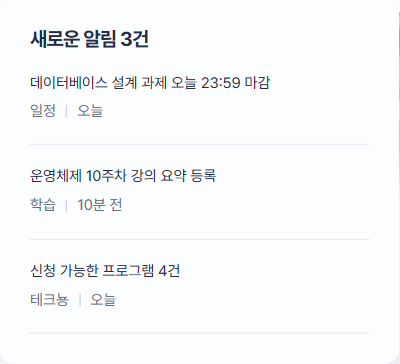
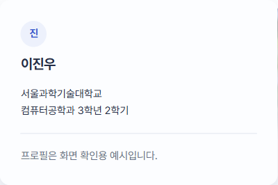

# 화면 명세 00. 공통 요소 v0.1

2026-11-06 기준 목업 · 작성: 이진우 · 전체 명세: [캠퍼스 올인원 플랫폼 구현 명세 v0.1](../../캠퍼스%20올인원%20플랫폼%20구현%20명세%20v0.1.md)

## 1. 개요

모든 화면이 같은 틀을 쓴다. 위에서부터 상단 바, 캠퍼스 사진 배너, 화면 제목, 화면별 본문, 푸터 순서이고, 오른쪽 아래에 테크뇽 버튼이 항상 떠 있다. 메뉴를 바꾸면 본문만 바뀌고 틀은 그대로다.

- **화면 목록:** 홈(01), 나의 일정(02), 학습(03), 학교 소식(04), 복지·취업(05), 테크뇽 추천 패널(06), 상세보기·일정 추가 대화상자(07)
- **목업 파일:** `index.html`(구조), `styles.css`(화면 규칙), `tokens.css`(색·글꼴·간격 값), `base.css`(공통 기본값), `app.js`(예시 데이터와 동작)
- **예시 기준일:** 2026년 11월 6일 금요일, 2학기 10주차

## 2. 화면 구성

| 영역 | 내용 | 실서비스 데이터 원천 |
| --- | --- | --- |
| 브랜드 | 로고 `on`, 서비스명 "캠퍼스 온", 학교명. 누르면 홈으로 이동하고 맨 위로 스크롤 | 학교 설정(`school_id`) |
| 주 메뉴 | 홈, 나의 일정, 학습, 학교 소식, 복지·취업. 현재 메뉴는 파란 글자와 밑줄 | 고정 |
| 알림 버튼 | 종 아이콘과 빨간 점(안 읽은 알림 있음). 누르면 알림 팝오버 | F3 마감 알림, F4 요약 등록, F5 추천 |
| 프로필 버튼 | 이름 첫 글자 원, 이름, 펼침 화살표. 누르면 프로필 팝오버 | F1 프로필 |
| 캠퍼스 배너 | 제목 "진우님, 오늘 남은 할 일 N건", 아래 줄에 날짜, 학기 주차, 학과 학년. 오른쪽은 캠퍼스 사진 | N은 오늘 마감 전 할 일 수(F3), 학기 주차는 학사력 |
| 화면 제목 | 메뉴에 따라 "나의 하루", "나의 일정", "나의 학습 자료", "학교 소식", "복지·취업정보" | 고정 |
| 푸터 | 서비스명, "예시 데이터 기반 UI 목업입니다." 안내 | 고정 |
| 테크뇽 버튼 | 공식 정면 포즈, 추천 수 배지 "4". 1600px 이상에서는 옆에 "기숙사 추가신청 마감 D-4" 말풍선 | F5 능동 추천 |

상단 바와 캠퍼스 배너도 중앙 고정폭 제한 없이 화면 폭을 사용한다. 내부 좌우 여백은 1200px 이상 32px, 640–1199px 24px, 639px 이하 20px이며, 로고와 배너 제목의 왼쪽 기준선을 맞춘다.

 

## 3. 동작

- 메뉴를 누르면 본문 구역을 그 메뉴에 해당하는 것만 남기고, 화면 제목을 바꾸고, 열린 팝오버를 닫는다. 주소(URL)는 바뀌지 않는다.
- 알림과 프로필 팝오버는 한 번에 하나만 열린다. 팝오버 바깥을 누르거나 Escape를 누르면 닫히고, Escape로 닫으면 포커스가 연 버튼으로 돌아간다.
- 테크뇽 버튼은 페이지가 열린 뒤 아래에서 떠오르며 나타나고, 마우스를 올리면 살짝 올라간다. 누르면 추천 패널(06)이 열리고 버튼이 닫기(×)로 바뀐다.
- 브라우저의 "동작 줄이기"가 켜져 있으면 나타나기, 올라가기, 패널 열기·닫기 애니메이션을 모두 생략한다.

## 4. 알림 팝오버 내용

| 알림 | 출처 | 시점 |
| --- | --- | --- |
| 데이터베이스 설계 과제 오늘 23:59 마감 | 일정 | 오늘 |
| 운영체제 10주차 강의 요약 등록 | 학습 | 10분 전 |
| 신청 가능한 프로그램 4건 | 테크뇽 | 오늘 |

프로필 팝오버는 이름(이진우), 학교, "컴퓨터공학과 3학년 2학기", "프로필은 화면 확인용 예시입니다." 안내를 보여준다.

## 5. 디자인 규칙

색, 글꼴, 글자 크기, 간격, 모서리, 그림자, 움직임 시간은 모두 `tokens.css`의 값을 쓴다. `styles.css`에 색이나 글꼴을 직접 적지 않는다.

| 항목 | 값 | 쓰는 곳 |
| --- | --- | --- |
| 강조 파랑 `--color-accent` | #3659ce | 버튼, 링크, 현재 메뉴, 선택한 날짜, 진행 막대 |
| 마감 빨강 `--color-alert` | #b4503c | "오늘 마감" 숫자와 배지, 안 읽은 알림 점, 추천 수 배지 |
| 본문 글자 `--color-ink` | #242d46 | 제목, 본문 |
| 보조 글자 `--color-muted` | #667085 | 날짜, 출처 같은 보조 정보. 흰 배경에서 4.5:1 이상 |
| 배경 `--color-paper` | #f7f8fc | 페이지 바탕. 카드는 `--color-surface` |
| 글꼴 | Pretendard JP 400·600·700 | 전체. e-class와 같은 글꼴 |
| 글자 크기 | 12 / 14 / 16 / 19.2 / 23 / 27.6 / 33px (1.2배 단계) | 12px보다 작은 글자는 쓰지 않음 |
| 간격 | 4px 단위(4, 8, 12, 16, 24, 40px …) | 여백, 간격 |
| 모서리 | 카드 12px, 버튼 8px, 태그 6px | |

- **문구:** 슬로건, 응원 문구, 영문 소제목, 장식 화살표를 쓰지 않고 날짜, 마감, 장소 같은 사실만 쓴다. 제목 위에 작은 분류 글씨를 두지 않는다.
- **정보 줄:** "학사지원과 | 11.06"처럼 가운뎃점 대신 얇은 세로선으로 나눈다(`.meta`).
- **버튼 문구:** "모집 내용 보기"처럼 동작으로 쓴다.
- **테크뇽:** 학교 공식 그림을 색, 필터, 부분 자르기 없이 그대로 쓰고 뒤에 장식 배경을 깔지 않는다. 공식 색 지정(팬톤 7544 C 몸, 7626 C 빨간 뿔, 7684 C 파란 뿔 등)을 바꾸지 않는다.
- **포커스:** 키보드로 이동하면 모든 버튼과 링크에 파란 테두리가 바로 보인다.

## 6. 반응형 기준

| 화면 폭 | 바뀌는 점 |
| --- | --- |
| 1600px 이상 | 배너 높이 160px, 테크뇽 말풍선 표시 |
| 1599px 이하 | 테크뇽 말풍선 숨김(내용을 가려서). 같은 내용은 추천 패널에 있음 |
| 1200px 이상 | 왼쪽 학교 서비스 바로가기, 중앙 본문, 오른쪽 다음 수업·다가오는 마감의 3영역 배치 |
| 768–1199px | 바로가기를 상단 가로 메뉴로 전환. 중앙 본문과 오른쪽 정보는 2영역 유지, 수강과목·프로그램은 각 1열 |
| 767px 이하 | 본문과 오른쪽 정보를 세로로 배치하고 푸터는 마지막에 표시 |
| 639px 이하 | 메뉴가 로고 아래 줄로 내려감, 요약 줄 보조 글씨 숨김, 추천 패널이 화면 폭에 맞춰 펼쳐짐 |

## 7. 미결 사항

- 메뉴 이동이 주소에 남지 않아 새로고침하면 홈으로 돌아간다. 실서비스에서는 `/schedule`처럼 주소를 나눠야 한다.
- 알림, 프로필, 학기 주차는 고정 예시 값이다. 알림 읽음 처리와 알림 전체 보기 화면은 아직 없다.
- 테크뇽 캐릭터 사용에 학교 허가가 필요한지 확인해야 한다(전체 명세 9장 미결 사항).

## 8. PC 사이드 영역

- 모든 화면의 본문 틀은 최대 폭 제한 없이 브라우저 폭을 사용한다. 일반 화면의 좌우 여백은 768px 이상 24px(1200px 이상 32px), 767px 이하 20px이다. 학습 자료 화면은 양쪽 보조 영역을 숨기며 좌우 여백은 768px 이상 24px, 767px 이하 16px이다.
- 왼쪽은 e-class, 학생포털·통합정보, 중앙도서관, 학교 홈페이지 바로가기다. 외부 학교 서비스는 새 탭에서 열며 계정 연동은 하지 않는다.
- 오른쪽은 기존 다음 수업·이번 주 수업 정보를 이동한 영역이다. 본문에 같은 정보를 중복해서 표시하지 않는다.
- 다가오는 마감은 고정 기준일 2026-11-06 이후의 샘플 일정 2건이다. 온라인 강의는 나의 일정 화면으로, 기숙사 신청은 기존 상세보기로 연결된다.
- 학습·학교 소식·복지·취업 단독 화면에서는 오른쪽 영역을 숨겨 본문 폭을 확보한다.
- 바로가기 편집 및 실제 마감 데이터 연동은 제공하지 않는다. 실제 신청 기한은 학교 공지를 확인해야 한다.
- 검증: 390/768/1024/1440px에서 가로 넘침 없음, 마감 상세·일정 이동·메뉴 전환·FAB 열기 동작 확인.
