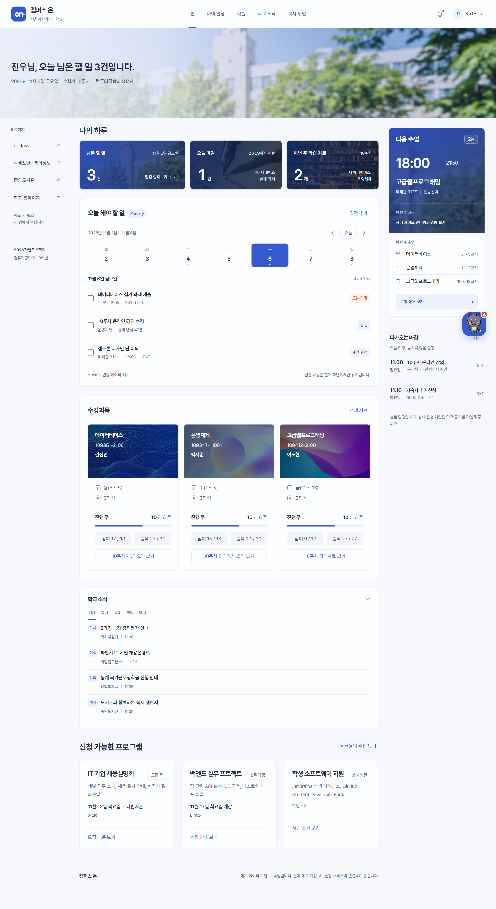
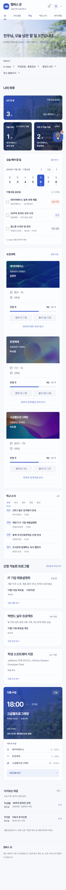

# 화면 명세 01. 홈 (나의 하루) v0.1

2026-11-06 기준 목업 · 작성: 이진우 · 공통 요소: [00. 공통](00-공통.md)

## 1. 개요

로그인한 학생이 처음 보는 화면이다. 오늘 할 일, 다음 수업, 수강과목, 학교 소식, 신청 가능한 프로그램을 한 화면에 모아, 포털과 e-class를 따로 열지 않아도 오늘 해야 할 일을 알 수 있게 한다. 각 구역은 해당 메뉴 화면(02~05)의 요약판이다.

- **진입:** 로그인 직후, 로고 클릭, 메뉴 "홈"
- **관련 기능:** F2 e-class 연동, F3 Planary 일정관리, F4 학습 보조, F5 테크뇽, F6 학교 공지 통합

## 2. 화면 구성

위에서부터 아래 순서다. 1440px 기준 3단 격자이고, 오른쪽 단은 다음 수업과 학교 소식이 차지한다.

| 순서 | 구역 | 내용 | 자세한 명세 |
| --- | --- | --- | --- |
| 1 | 요약 줄 | 남은 할 일, 오늘 마감, 이번 주 학습 자료 세 숫자와 "일정 살펴보기" | 아래 3장 |
| 2 | 오늘 해야 할 일 (2단 폭) | Planary 주간 날짜 띠와 선택한 날짜의 할 일 목록 | [02. 나의 일정](02-나의-일정.md) |
| 2 | 다음 수업 (1단 폭) | 다음 수업 시간, 과목, 강의실, 이번 주 학습 주제, 이번 주 수업 목록 | 아래 4장 |
| 3 | 수강과목 (2단 폭) | e-class 형식의 과목 카드 3장 | [03. 학습](03-학습.md) |
| 3 | 학교 소식 (1단 폭) | 분류 탭과 공지 4건 | [04. 학교 소식](04-학교-소식.md) |
| 4 | 신청 가능한 프로그램 (전체 폭) | 프로그램 카드 3장 | [05. 복지·취업](05-복지-취업.md) |

## 3. 요약 줄

| 항목 | 예시 값 | 계산 | 실서비스 데이터 원천 |
| --- | --- | --- | --- |
| 남은 할 일 | 3건, "11월 6일 금요일" | 오늘 날짜의 할 일 중 완료하지 않은 것. 체크하면 바로 줄어들고 배너 제목의 숫자도 같이 바뀜 | F3 할 일 |
| 오늘 마감 | 1건, "데이터베이스 설계 과제", "23:59까지 제출" | 오늘 날짜의 마감 할 일 중 완료하지 않은 것 | F2 과제 마감일 |
| 이번 주 학습 자료 | 2개, "데이터베이스, 운영체제", "10주차" | 고정 예시 값 | F4 이번 주 새 요약 수 |

세 카드 모두 상단에 항목명과 날짜·마감 시각·주차를, 하단 왼쪽에 같은 크기의 큰 숫자를 둔다. 하단 오른쪽은 일정 버튼 또는 과제·과목 정보다. 숫자는 PC 44px, 모바일 36px이며, 모바일의 마감·학습 카드에서는 상세 정보를 숫자 아래로 배치한다.

단색 대신 캠퍼스·필기·서가 사진을 각 카드 배경으로 쓴다. 블루·네이비 계열 오버레이와 흰색 글자로 통일하며, 사진이 로드되지 않아도 어두운 배경색 위에서 읽을 수 있다. 새 사진은 로컬 WebP 자산으로 저장해 화면 실행 시 외부 이미지 서비스에 의존하지 않는다.

"일정 살펴보기"는 남은 할 일 카드 안에 두고, 누르면 나의 일정(02)으로 이동한다. 모든 화면 폭에서 표시하며 키보드 포커스에는 흰색 테두리를 표시한다.

1200px 이상에서는 세 카드를 가로로 놓고 첫 카드를 조금 넓게 잡는다. 1199px 이하에서는 남은 할 일이 첫 행 전체를 차지하고 마감·학습 자료가 둘째 행에 나란히 놓인다. 모바일에서도 상세 내용과 보조 정보를 숨기지 않는다.

## 4. 다음 수업

| 항목 | 예시 값 | 실서비스 데이터 원천 |
| --- | --- | --- |
| 시간 | 18:00 ~ 21:50 (시작 시각 40px, 흰색) | 시간표 |
| 과목 | 고급웹프로그래밍 | 시간표 |
| 정보 줄 | 미래관 312호 \| 전공선택 | 시간표 |
| 이번 주에는 | 서버 사이드 렌더링과 API 설계 | F2 강의계획서 주차 정보 |
| 이번 주 수업 | 월 데이터베이스 3 ~ 5교시, 수 운영체제 1 ~ 3교시, 금 고급웹프로그래밍 10 ~ 13교시 (오늘인 금요일은 파란 글자) | 시간표 |
| 수업 정보 보기 | 상세보기 대화상자(07, `class`)를 연다 | |

카드 상단은 캠퍼스 사진과 블루·네이비 오버레이를 사용한다. 제목과 "오늘" 태그, 큰 시작 시각, 과목·강의실, 이번 주 학습 주제를 흰색 글자로 보여준다. 사진은 기존 로컬 `assets/campus.webp`를 재사용하고, 사진이 없어도 어두운 바탕에서 글자가 보인다.

하단은 밝은 배경으로 분리해 이번 주 수업 목록을 읽기 쉽게 유지한다. "수업 정보 보기"는 하단 전체 폭 버튼이며, 기존 상세보기와 닫은 뒤 버튼으로 돌아오는 포커스 동작을 유지한다.

오른쪽 위 "오늘" 태그는 다음 수업이 오늘이라는 뜻이다. 모바일에서도 학습 주제를 시간 오른쪽에 겹쳐 놓지 않고 과목 정보 아래에 자연스럽게 배치한다.

## 5. 동작

- 할 일 체크, 날짜 선택, 일정 추가는 나의 일정(02)과 같다. 홈에서 바꾼 내용은 나의 일정 화면에도 그대로 보인다.
- 과목 카드, 공지, 프로그램 카드의 버튼은 각각 상세보기 대화상자(07)를 연다.
- "전체 자료", "테크뇽의 추천 보기"는 각각 학습(03) 화면 이동, 추천 패널(06) 열기다.

## 6. 반응형

| 화면 폭 | 배치 |
| --- | --- |
| 1200px 이상 | 3단. 할 일과 수강과목이 2단, 다음 수업과 학교 소식이 1단 |
| 960 ~ 1199px | 3단 유지, 오른쪽 단 최소 240px |
| 640 ~ 959px | 2단. 할 일과 다음 수업이 나란히, 수강과목과 학교 소식은 전체 폭(학교 소식 목록 2열) |
| 639px 이하 | 1단. 다음 수업은 사진 영역 아래에 이번 주 시간표를 세로로 배치하며, 학습 주제는 과목 정보 아래에 유지 |

## 7. 미결 사항

- 1440px에서 학교 소식 구역이 옆의 수강과목 높이에 맞춰 늘어나 아래가 약 130px 비어 있다. 배치를 바꿔야 고칠 수 있어 그대로 두었다.
- 배너 제목의 "남은 할 일"과 요약 줄의 "남은 할 일"이 같은 숫자를 두 번 보여준다.
- 다음 수업, 이번 주 수업, 이번 주 학습 자료 수는 고정 예시다. 실서비스에서는 시간표와 현재 시각으로 계산해야 하고, 오늘 수업이 끝났을 때 보여줄 내용을 정해야 한다.
