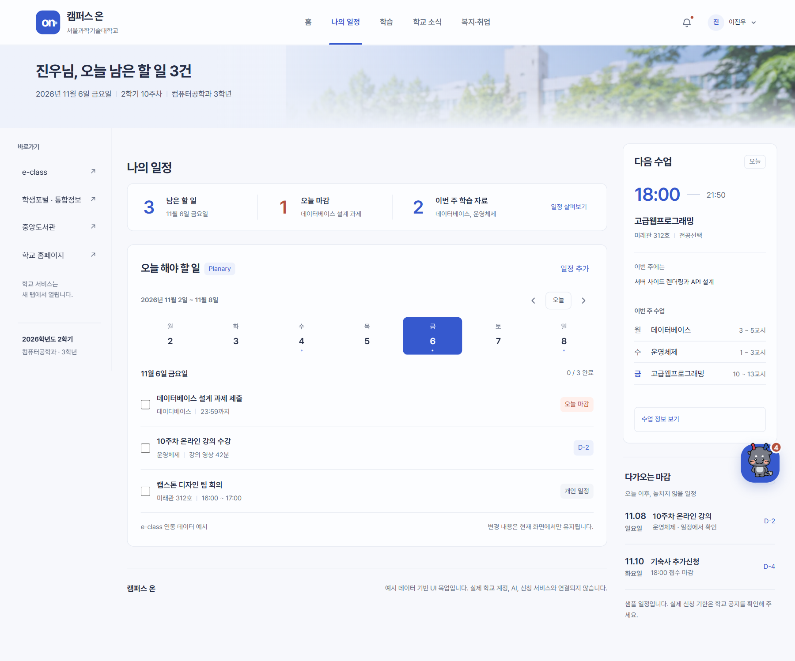
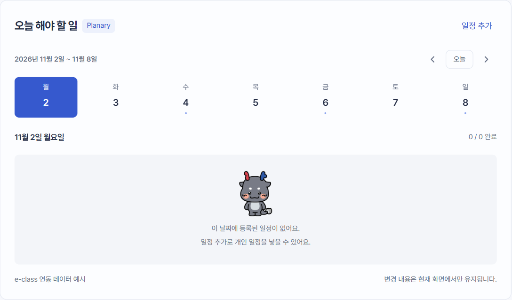
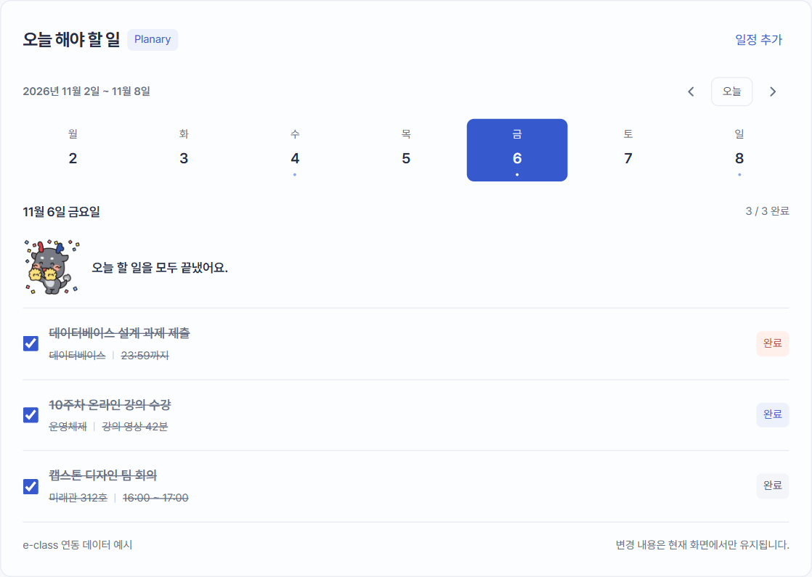
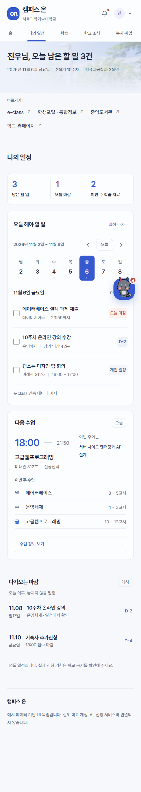

# 화면 명세 02. 나의 일정 (Planary) v0.1

2026-11-06 기준 목업 · 작성: 이진우 · 공통 요소: [00. 공통](00-공통.md)

## 1. 개요

e-class 과제와 강의, 개인 일정을 하나의 주간 할 일 목록으로 보여주는 Planary 화면이다. 학생은 날짜를 골라 그날 할 일을 확인하고, 다 한 일을 체크하고, 개인 일정을 추가한다.

- **진입:** 메뉴 "나의 일정", 홈 요약 줄의 "일정 살펴보기"
- **관련 기능:** F2 e-class 연동(과제·강의), F3 Planary 일정관리
- **본문:** 요약 줄 + 오늘 해야 할 일 구역을 전체 폭으로 보여준다. 다음 수업 구역은 이 화면에서 숨긴다.

## 2. 화면 구성

| 영역 | 내용 |
| --- | --- |
| 머리 | "오늘 해야 할 일" 제목, "Planary" 태그(데이터 출처), "일정 추가" 버튼 |
| 주 표시줄 | "2026년 11월 2일 ~ 11월 8일", 이전 주(‹), "오늘", 다음 주(›) |
| 날짜 띠 | 월~일 7칸. 칸마다 요일과 날짜, 할 일이 있는 날은 아래에 작은 점. 선택한 날은 파란 칸 |
| 목록 머리 | 선택한 날짜("11월 6일 금요일")와 완료 수("0 / 3 완료") |
| 할 일 줄 | 체크박스, 제목, 정보 줄(과목 또는 장소 \| 시간), 오른쪽 배지 |
| 바닥 | "e-class 연동 데이터 예시", "변경 내용은 현재 화면에서만 유지됩니다." (959px 이하에서는 뒤 문장 숨김) |

## 3. 할 일 데이터

| 날짜 | 제목 | 정보 줄 | 배지 | 종류 | 처음 상태 |
| --- | --- | --- | --- | --- | --- |
| 11/6(금) | 데이터베이스 설계 과제 제출 | 데이터베이스 \| 23:59까지 | 오늘 마감 | 마감(`urgent`, 빨강) | 미완료 |
| 11/6(금) | 10주차 온라인 강의 수강 | 운영체제 \| 강의 영상 42분 | D-2 | 일반(파랑) | 미완료 |
| 11/6(금) | 캡스톤 디자인 팀 회의 | 미래관 312호 \| 16:00 ~ 17:00 | 개인 일정 | 개인(`personal`, 회색) | 미완료 |
| 11/4(수) | 운영체제 스터디 | 중앙도서관 \| 18:00 | 개인 일정 | 개인 | 완료 |
| 11/8(일) | 알고리즘 문제 풀이 | 개인 학습 \| 14:00 | 개인 일정 | 개인 | 미완료 |

할 일 한 건의 필드는 `id`, `date`(YYYY-MM-DD), `title`, `meta`(정보 줄 두 칸), `badge`, `kind`(`urgent` / 빈 값 / `personal`), `done`이다. 실서비스에서는 F2가 과제·강의를, 사용자가 개인 일정을 만든다.

## 4. 동작

- **날짜 선택:** 날짜 칸을 누르면 그날 할 일을 보여준다.
- **주 이동:** ‹ ›는 일주일씩 이동하고, 이동한 주의 월요일을 선택한다. "오늘"은 11월 6일과 그 주로 돌아온다.
- **완료 체크:** 체크하면 제목과 정보 줄에 취소선이 그어지고 배지가 "완료"로 바뀐다. 완료 수, 요약 줄 숫자, 배너 제목 숫자가 바로 바뀐다. 알림창은 띄우지 않는다.
- **일정 추가:** "일정 추가"를 누르면 일정 추가 대화상자(07)가 열린다. 날짜 칸은 지금 선택한 날짜로 채워진다. 추가하면 그 날짜와 주로 이동해 새 일정을 보여준다.
- 바꾼 내용은 메모리에만 있어서 새로고침하면 처음 상태로 돌아간다.

## 5. 상태

| 상태 | 조건 | 표시 |
| --- | --- | --- |
| 기본 | 선택한 날짜에 미완료 할 일이 있음 | 할 일 목록 |
| 빈 날짜 | 선택한 날짜에 할 일이 없음 | 테크뇽 정면 포즈, "이 날짜에 등록된 일정이 없어요.", "일정 추가로 개인 일정을 넣을 수 있어요." |
| 모두 완료 | 선택한 날짜의 할 일을 모두 체크함 | 목록 맨 위에 테크뇽 응원 표정과 "오늘 할 일을 모두 끝냈어요." (오늘이 아니면 "11월 4일 수요일의 할 일을 모두 끝냈어요.") |
| 선택한 날 | 날짜 칸을 누름 | 파란 칸, 흰 글자 |

## 6. 반응형

- 959px 이하: 홈에서는 다음 수업과 나란히 2단이 되고 "Planary" 태그를 숨긴다.
- 639px 이하: 날짜 칸 간격이 4px로 좁아지고, 할 일 줄의 체크박스와 제목 간격이 8px로 줄어든다.

## 7. 미결 사항

- 불러오는 중, e-class 연동 실패 상태는 목업에 없다. 연동이 끊겼을 때 어떤 안내와 버튼(다시 연결, 수동 동기화)을 보여줄지 정해야 한다.
- 할 일 수정과 삭제, 마감 임박 푸시 알림(F3), 외부 캘린더 구독 주소 발급(F3) 화면이 아직 없다.
- D-2 같은 배지는 고정 문구다. 실서비스에서는 마감일과 오늘 날짜로 계산해야 한다.
