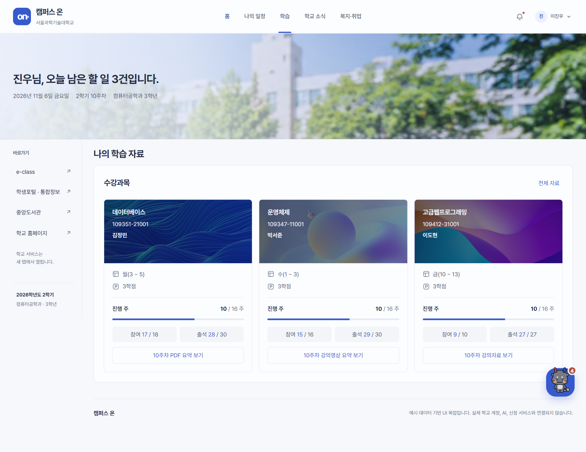
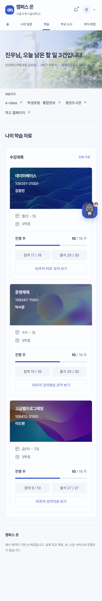

# 화면 명세 03. 학습 (나의 학습 자료) v0.1

2026-11-06 기준 목업 · 작성: 이진우 · 공통 요소: [00. 공통](00-공통.md)

## 1. 개요

이번 학기 수강과목을 e-class 과목 카드 형식으로 보여주고, 과목마다 이번 주 자료의 학습 자료 화면(08)으로 바로 들어가게 한다. 학생이 e-class에 들어가 PDF를 열거나 영상을 끝까지 보지 않아도 핵심을 먼저 볼 수 있게 하는 것이 목적이다.

- **진입:** 메뉴 "학습", 홈 수강과목 구역의 "전체 자료"
- **관련 기능:** F2 e-class 연동(과목, 진행 주차, 출석), F4 학습 보조(PDF 요약, 영상 요약)
- **본문:** 수강과목 구역만 전체 폭으로 보여준다.

## 2. 과목 카드 구성

e-class 과목 카드의 정보 순서는 유지하고, 표지에는 과목별 추상 이미지를 적용한다. 구체적인 데이터베이스·원자·레이어 아이콘 대신 파동·진주빛 곡면·흐르는 색면을 사용하며, 참고 캡처에 나온 이미지는 재사용하지 않는다.

| 과목 | 기본 이미지 | 자산 |
| --- | --- | --- |
| 데이터베이스 | 블루 계열의 미세한 파동 | `assets/course-database.webp` |
| 운영체제 | 진주빛 곡면과 부유하는 구체 | `assets/course-os.webp` |
| 고급웹프로그래밍 | 청록·보라·오렌지가 흐르는 색면 | `assets/course-web.webp` |

세 이미지는 1200×600px 로컬 WebP다. 표지는 최소 높이 156px, `background-size: cover`이며, 좌측을 더 어둡게 하는 오버레이로 과목명·학수번호·교수명을 읽기 쉽게 유지한다. 홈과 학습 화면에 같은 이미지를 사용한다. 이미지가 로드되지 않을 때는 기존 과목별 바탕색이 남는다.

| 영역 | 내용 | 실서비스 데이터 원천 |
| --- | --- | --- |
| 표지 | 과목명, 학수번호, 담당 교수 | F2 수강 목록 |
| 시간 | 달력 아이콘 + 요일(교시) | F2 또는 시간표 |
| 학점 | P 아이콘 + 학점 | F2 |
| 진행 주 | "10 / 16 주"와 진행 막대 | 학사력 |
| 참여 · 출석 | 두 칸. 파란 숫자가 현재 값 | F2 출석·온라인 강의 수강 기록 |
| 자료 버튼 | 이번 주 자료 보기. 학습 자료 화면(08)을 연다 | F4 |

## 3. 과목 데이터 (예시 값)

| 과목 | 학수번호 | 교수 | 요일(교시) | 학점 | 진행 | 참여 | 출석 | 버튼 → 상세 |
| --- | --- | --- | --- | --- | --- | --- | --- | --- |
| 데이터베이스 | 109351-21001 | 김정민 | 월(3 ~ 5) | 3 | 10 / 16 | 17 / 18 | 28 / 30 | 10주차 PDF 요약 보기 → 08, `db-10` |
| 운영체제 | 109347-11001 | 박서준 | 수(1 ~ 3) | 3 | 10 / 16 | 15 / 16 | 29 / 30 | 10주차 강의영상 요약 보기 → 08, `os-10` |
| 고급웹프로그래밍 | 109412-31001 | 이도현 | 금(10 ~ 13) | 3 | 10 / 16 | 9 / 10 | 27 / 27 | 10주차 강의자료 보기 → 08, `web-10` |

학수번호, 교수 이름, 교시, 참여·출석 수치는 모두 화면 확인용으로 만든 값이다. 실제 수업 정보로 쓰면 안 된다.

## 4. 동작

- 자료 버튼은 학습 자료 화면(08)을 열고 해당 주차 자료를 선택한다. 버튼의 `data-course`, `data-material`이 과목과 자료를 정한다.
- 고급웹프로그래밍 수업 정보(시간, 강의실)는 오른쪽 다음 수업 영역의 "수업 정보 보기"(07, `class`)에서 본다.
- 카드 자체는 누를 수 없다. 버튼만 반응한다.

## 5. 반응형

과목 카드 격자는 칸 최소 168px로 화면 폭에 맞춰 채운다.

| 화면 폭 | 한 줄 카드 수 |
| --- | --- |
| 1024px 이상 | 3장 |
| 639px 이하 | 1장 |

## 6. 미결 사항

- 과목이 4개 이상일 때 카드 순서(요일 순, 최근 자료 순)를 정해야 한다.
- 카드에 이번 주 자료의 요약 상태(요약 중, 요약 실패)를 미리 보여줄지 정해야 한다. 지금은 학습 자료 화면(08)에서만 보인다.
