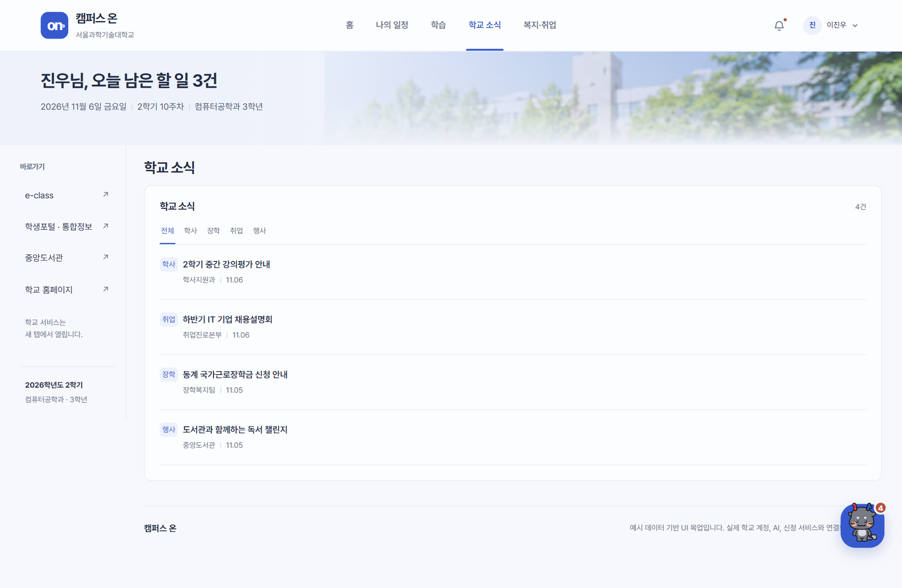
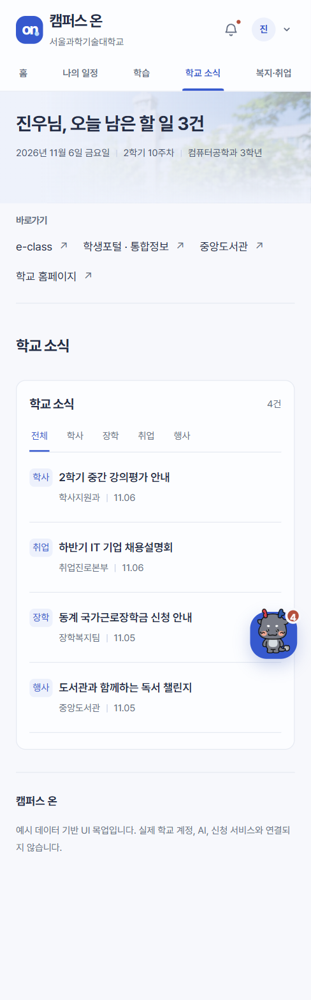

# 화면 명세 04. 학교 소식 v0.1

2026-11-06 기준 목업 · 작성: 이진우 · 공통 요소: [00. 공통](00-공통.md)

## 1. 개요

학교 공지, 취업진로본부, 장학복지팀, 중앙도서관처럼 흩어진 부서별 공지를 한 목록에 모은다. 학생은 분류 탭으로 필요한 공지만 골라 보고, 눌러서 내용을 확인한다.

- **진입:** 메뉴 "학교 소식", 홈 학교 소식 구역
- **관련 기능:** F6 학교 공지 통합(수집, 분류, 한 줄 요약)
- **본문:** 학교 소식 구역만 전체 폭으로 보여준다. 홈보다 줄 간격을 넓힌다.

## 2. 화면 구성

| 영역 | 내용 |
| --- | --- |
| 머리 | "학교 소식" 제목, 오른쪽에 현재 보이는 공지 수("4건") |
| 분류 탭 | 전체, 학사, 장학, 취업, 행사. 선택한 탭은 파란 글자와 밑줄 |
| 공지 줄 | 왼쪽 분류 태그, 제목, 정보 줄(부서 \| 게시일). 줄 전체가 버튼 |

## 3. 공지 데이터 (예시 값)

| 분류 | 제목 | 부서 | 게시일 | 상세 키 | 상세 제목 |
| --- | --- | --- | --- | --- | --- |
| 학사 | 2학기 중간 강의평가 안내 | 학사지원과 | 11.06 | `academic` | 2026학년도 2학기 중간 강의평가 안내 |
| 취업 | 하반기 IT 기업 채용설명회 | 취업진로본부 | 11.06 | `career` | IT 기업 채용설명회 |
| 장학 | 동계 국가근로장학금 신청 안내 | 장학복지팀 | 11.05 | `scholarship` | 동계 국가근로장학금 신청 안내 |
| 행사 | 도서관과 함께하는 독서 챌린지 | 중앙도서관 | 11.05 | `event` | 가을 독서 챌린지 참여 안내 |

공지 한 건의 필드는 `category`, `title`, `source`(부서, 게시일), `detail`(상세 키)이다. 실서비스에서는 F6 수집기가 부서별 사이트에서 가져오고, LLM이 분류와 한 줄 요약을 붙인다.

## 4. 동작

- 분류 탭을 누르면 그 분류의 공지만 보이고 오른쪽 수가 바뀐다(예: 행사 → "1건"). 탭은 버튼 묶음이고 선택 상태를 `aria-pressed`로 알린다.
- 공지 줄을 누르면 상세보기 대화상자(07)가 열린다. 제목 아래에 "학사지원과 학사 공지"처럼 출처가 붙는다.
- 선택한 탭은 메뉴를 바꾸면 초기화되지 않지만, 새로고침하면 "전체"로 돌아간다.

## 5. 반응형

| 화면 폭 | 배치 |
| --- | --- |
| 960px 이상 | 홈에서는 오른쪽 단, 이 화면에서는 전체 폭 한 줄 목록 |
| 640 ~ 959px | 공지 목록 2열 |
| 639px 이하 | 1열, 탭 간격 20px |

## 6. 미결 사항

- 공지가 많을 때의 더 보기 또는 페이지 나누기가 없다.
- 선택한 분류에 공지가 하나도 없을 때의 빈 상태 문구가 없다.
- 원문 공지로 가는 링크와 첨부파일 표시가 없다.
- 학년·학과 태깅(F6)에 따라 목록을 걸러 보여줄지 정해야 한다.
