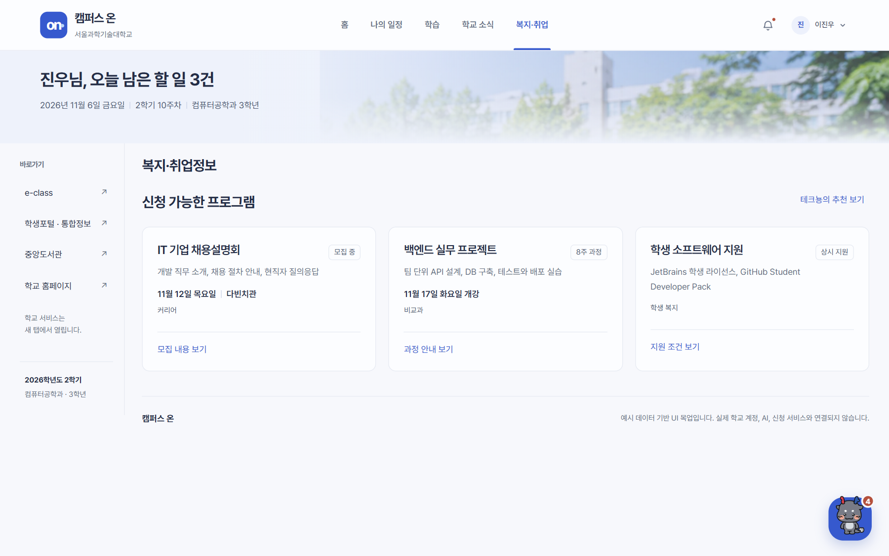
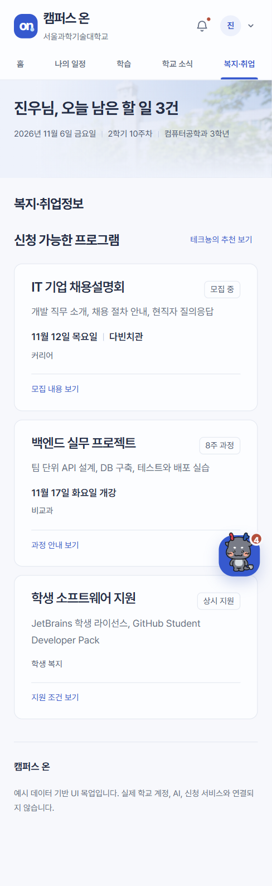

# 화면 명세 05. 복지·취업 (신청 가능한 프로그램) v0.1

2026-11-06 기준 목업 · 작성: 이진우 · 공통 요소: [00. 공통](00-공통.md)

## 1. 개요

학생의 학과와 학년에 맞는 취업 설명회, 비교과 과정, 학생 복지 혜택을 카드로 보여준다. 학생은 일정과 장소를 먼저 보고, 관심 있는 프로그램의 모집 내용을 연다. 테크뇽 추천 패널(06)은 같은 프로그램을 개인 추천으로 다시 보여준다.

- **진입:** 메뉴 "복지·취업", 홈 신청 가능한 프로그램 구역
- **관련 기능:** F5 테크뇽 능동 추천, F6 공지 통합(대상 학년·학과 태깅)
- **본문:** 신청 가능한 프로그램 구역만 보여준다. 화면 제목은 "복지·취업정보"다.

## 2. 카드 구성

| 순서 | 영역 | 내용 |
| --- | --- | --- |
| 1 | 제목 줄 | 프로그램 이름(왼쪽), 상태 태그(오른쪽: 모집 중, 8주 과정, 상시 지원) |
| 2 | 설명 | 한 줄 설명 |
| 3 | 일정 | 날짜와 장소를 굵은 14px로. 신청 카드에서 가장 먼저 찾는 정보라 따로 줄을 둔다 |
| 4 | 분류 | 커리어, 비교과, 학생 복지 |
| 5 | 버튼 | 동작 문구. 누르면 상세보기 대화상자(07) |

## 3. 프로그램 데이터 (예시 값)

| 프로그램 | 상태 | 설명 | 일정 | 분류 | 버튼 → 상세 |
| --- | --- | --- | --- | --- | --- |
| IT 기업 채용설명회 | 모집 중 | 개발 직무 소개, 채용 절차 안내, 현직자 질의응답 | 11월 12일 목요일 \| 다빈치관 | 커리어 | 모집 내용 보기 → `career` |
| 백엔드 실무 프로젝트 | 8주 과정 | 팀 단위 API 설계, DB 구축, 테스트와 배포 실습 | 11월 17일 화요일 개강 | 비교과 | 과정 안내 보기 → `project` |
| 학생 소프트웨어 지원 | 상시 지원 | JetBrains 학생 라이선스, GitHub Student Developer Pack | (없음) | 학생 복지 | 지원 조건 보기 → `software` |

상세보기에는 추천 이유("취업 준비를 시작하는 컴퓨터공학과 3학년에게 적합한 직무 탐색 기회예요.")와 "실제 신청은 연결되지 않았습니다." 안내가 들어간다.

## 4. 동작

- 머리의 "테크뇽의 추천 보기"는 테크뇽 추천 패널(06)을 연다.
- 카드 버튼은 상세보기 대화상자(07)를 연다. 실제 신청, 개인정보 제출은 하지 않는다.

## 5. 반응형

| 화면 폭 | 배치 |
| --- | --- |
| 640px 이상 | 카드 3장 한 줄 |
| 639px 이하 | 카드 1장씩 세로, "테크뇽의 추천 보기"는 제목 아래 줄로 내려감 |

## 6. 미결 사항

- 신청 마감일, 남은 자리 같은 신청 정보가 카드에 없다. 원문 공고에서 가져올 수 있는지 F6에서 확인해야 한다.
- 신청하기 버튼을 둘지(외부 신청 페이지로 이동), 관심 표시와 알림 받기를 둘지 정해야 한다.
- 추천 대상 판단 기준(학과, 학년, 신청 기간)을 화면에 얼마나 드러낼지 정해야 한다.
