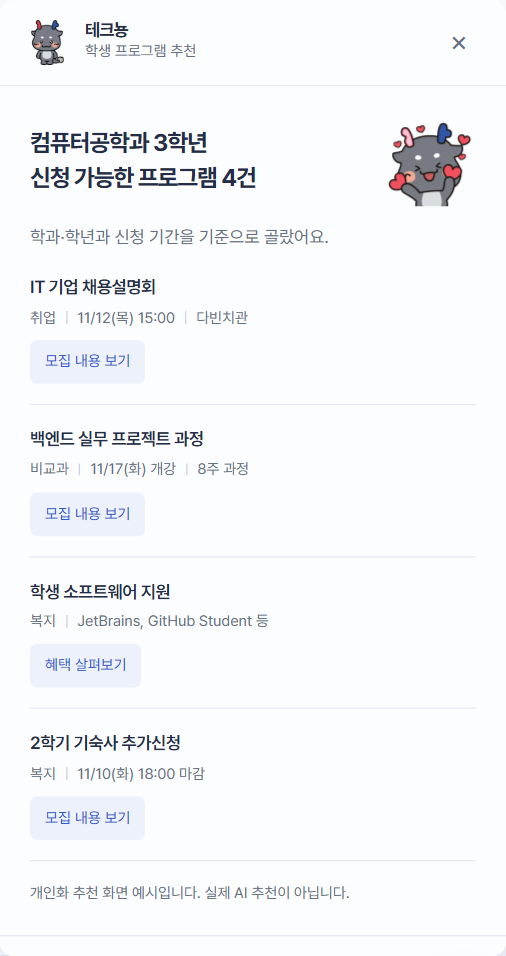
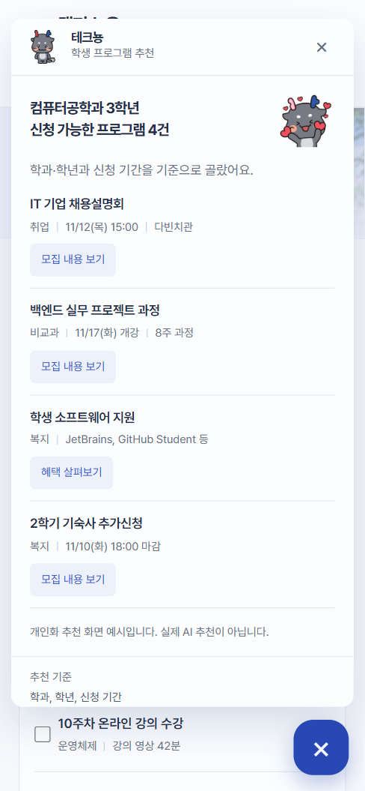

# 화면 명세 06. 테크뇽 추천 패널 v0.1

2026-11-06 기준 목업 · 작성: 이진우 · 공통 요소: [00. 공통](00-공통.md)

## 1. 개요

오른쪽 아래 테크뇽 버튼을 누르면 열리는 추천 패널이다. 학생의 학과, 학년, 신청 기간을 기준으로 지금 신청할 수 있는 프로그램을 먼저 알려준다. 실서비스에서는 같은 자리에서 자연어 질문(F5 수동 질문)까지 받는다.

- **진입:** 모든 화면의 테크뇽 버튼, 복지·취업 구역의 "테크뇽의 추천 보기"
- **관련 기능:** F5 AI 어시스턴트(능동 요약), F6 대상 학년·학과 태깅
- **캐릭터:** 서울과학기술대학교 공식 캐릭터 테크뇽. 공식 그림을 그대로 쓴다([00. 공통 5장](00-공통.md#5-디자인-규칙)).

## 2. 화면 구성

| 영역 | 내용 |
| --- | --- |
| 머리 | 테크뇽 정면 포즈(36px), "테크뇽", "학생 프로그램 추천", 닫기(×). 스크롤해도 위에 붙어 있음 |
| 첫 인사 | "컴퓨터공학과 3학년 / 신청 가능한 프로그램 4건"과 오른쪽 하트 표정(72px) |
| 기준 안내 | "학과·학년과 신청 기간을 기준으로 골랐어요." |
| 추천 목록 | 4건. 제목, 정보 줄(분류 \| 일정 \| 장소), 버튼 |
| 안내 | "개인화 추천 화면 예시입니다. 실제 AI 추천이 아닙니다." |
| 바닥 | "추천 기준: 학과, 학년, 신청 기간" |

## 3. 추천 데이터 (예시 값)

| 제목 | 정보 줄 | 버튼 → 상세 |
| --- | --- | --- |
| IT 기업 채용설명회 | 취업 \| 11/12(목) 15:00 \| 다빈치관 | 모집 내용 보기 → `career` |
| 백엔드 실무 프로젝트 과정 | 비교과 \| 11/17(화) 개강 \| 8주 과정 | 모집 내용 보기 → `project` |
| 학생 소프트웨어 지원 | 복지 \| JetBrains, GitHub Student 등 | 혜택 살펴보기 → `software` |
| 2학기 기숙사 추가신청 | 복지 \| 11/10(화) 18:00 마감 | 모집 내용 보기 → `dorm` |

추천 한 건은 `[분류, 제목, 정보 줄 칸들, 상세 키]`로 `app.js`의 `recommendations`에 있다.

## 4. 동작

- 버튼을 누르면 패널이 오른쪽 아래에서 커지며 열리고, 포커스가 닫기 버튼으로 간다. 테크뇽 버튼은 닫기(×) 모양으로 바뀌고 추천 수 배지가 사라진다.
- 닫기, 테크뇽 버튼 다시 누르기, Escape로 닫는다. 닫으면 포커스가 테크뇽 버튼으로 돌아간다.
- 추천 버튼을 누르면 패널은 열린 채로 상세보기 대화상자(07)가 위에 뜬다. 대화상자가 열려 있을 때 Escape는 대화상자만 닫는다.
- 동작 줄이기 설정에서는 열기·닫기 애니메이션 없이 바로 보이고 사라진다.

## 5. 반응형

| 화면 폭 | 배치 |
| --- | --- |
| 640px 이상 | 폭 405px, 테크뇽 버튼 위에 떠 있음. 화면 높이를 넘으면 패널 안에서 스크롤 |
| 639px 이하 | 좌우 12px 여백을 두고 화면 폭에 맞춤, 하트 표정 60px |

## 6. 미결 사항

- 대화 입력창(F5 수동 질문)과 답변 표시 방식이 없다. 크롬 Gemini 창처럼 이 패널 안에서 이어갈지 정해야 한다.
- 추천을 숨기거나 다시 보지 않기, 추천 이유 보기 기능이 없다.
- 불러오는 중(옆모습 포즈), 연결 실패(뒷모습 포즈)처럼 다른 공식 포즈를 상태별로 쓰는 안은 아직 화면에 넣지 않았다.
- 테크뇽 캐릭터 사용에 학교 허가가 필요한지 확인해야 한다.
