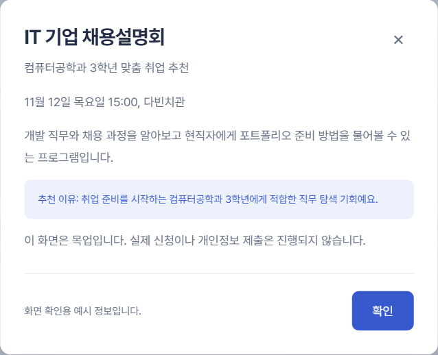
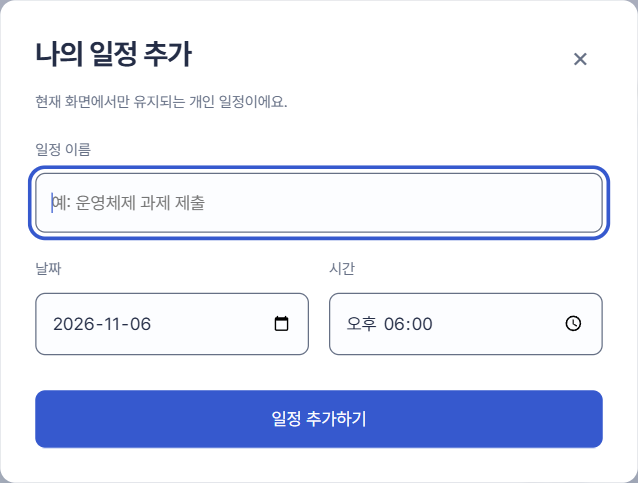

# 화면 명세 07. 상세보기 · 일정 추가 대화상자 v0.1

2026-11-06 기준 목업 · 작성: 이진우 · 공통 요소: [00. 공통](00-공통.md)

## 1. 개요

다른 화면 위에 뜨는 두 대화상자다. 상세보기는 자료 요약, 공지, 프로그램, 수업 정보를 한 형식으로 보여주고, 일정 추가는 Planary에 개인 일정을 넣는다. 둘 다 브라우저의 모달 대화상자(`<dialog>`)를 쓴다.

- **관련 기능:** F3 개인 일정 추가, F4 요약 보기, F6 공지 보기, F5 추천 상세

## 2. 상세보기

| 영역 | 내용 |
| --- | --- |
| 머리 | 제목(23px)과 닫기(×) |
| 출처 줄 | 제목 아래 회색 한 줄. 예: "데이터베이스 PDF 핵심 요약" |
| 본문 | 문단과 목록. 예시라는 안내 상자(연한 파랑)를 포함 |
| 바닥 | "화면 확인용 예시 정보입니다."와 "확인" 버튼 |

**상세 키와 내용 (`app.js`의 `details`)**

| 키 | 여는 곳 | 제목 | 출처 줄 |
| --- | --- | --- | --- |
| `class` | 다음 수업, 고급웹프로그래밍 카드 | 고급웹프로그래밍 | 이번 학기 수업 |
| `database` | 데이터베이스 카드 | 관계형 데이터베이스 설계 | 데이터베이스 PDF 핵심 요약 |
| `os` | 운영체제 카드 | 프로세스와 스레드 | 운영체제 강의 영상 핵심 요약 |
| `career` | 채용설명회 카드, 공지, 추천 | IT 기업 채용설명회 | 컴퓨터공학과 3학년 맞춤 취업 추천 |
| `project` | 프로젝트 카드, 추천 | 백엔드 실무 프로젝트 과정 | 전공 역량 비교과 프로그램 |
| `software` | 소프트웨어 카드, 추천 | 학생 소프트웨어 지원 | 학생 복지 소프트웨어 혜택 |
| `dorm` | 추천 | 2학기 기숙사 추가신청 | 생활관 모집 안내 |
| `academic` | 공지 | 2026학년도 2학기 중간 강의평가 안내 | 학사지원과 학사 공지 |
| `scholarship` | 공지 | 동계 국가근로장학금 신청 안내 | 장학복지팀 장학 공지 |
| `event` | 공지 | 가을 독서 챌린지 참여 안내 | 중앙도서관 행사 안내 |

## 3. 일정 추가

| 필드 | 형식 | 처음 값 | 검사 |
| --- | --- | --- | --- |
| 일정 이름 | 글자, 최대 80자 | 빈 칸(예: 운영체제 과제 제출) | 필수. 공백만 넣으면 "일정 이름을 입력해 주세요." |
| 날짜 | 날짜 선택 | 지금 선택한 날짜 | 필수 |
| 시간 | 시간 선택 | 18:00 | 필수 |

"일정 추가하기"를 누르면 개인 일정(`personal`, 배지 "개인 일정", 정보 줄 "개인 일정 \| 시간")으로 추가하고, 그 날짜로 이동한 뒤 대화상자를 닫는다. 화면 아래에 "개인 일정을 추가했어요. 새로고침하면 초기화됩니다." 알림이 약 3초 동안 뜬다. 저장은 메모리에만 한다.

## 4. 공통 동작

- 열리면 뒤쪽 화면이 어둡고 흐려지고, 상자가 아래에서 살짝 올라오며 나타난다.
- 닫기(×), "확인", Escape, 상자 바깥 클릭으로 닫는다.
- 일정 추가는 열릴 때 이름 칸에 포커스가 간다.

## 5. 반응형

- 폭은 510px, 화면이 좁으면 좌우 16px 여백을 남기고 줄어든다. 높이가 화면의 85%를 넘으면 안에서 스크롤한다.
- 639px 이하: 안쪽 여백 20px, 제목 19.2px.

## 6. 미결 사항

- 상세보기에 원문 공지, 원본 PDF, 강의 영상으로 가는 링크가 없다.
- 일정 수정과 삭제, 반복 일정, 알림 시간 설정이 없다.
- 일정 추가 완료 알림은 새 일정이 화면에 바로 보이므로, 저장이 서버에 연결되면 "새로고침하면 초기화" 안내와 함께 없애는 것을 검토한다.
