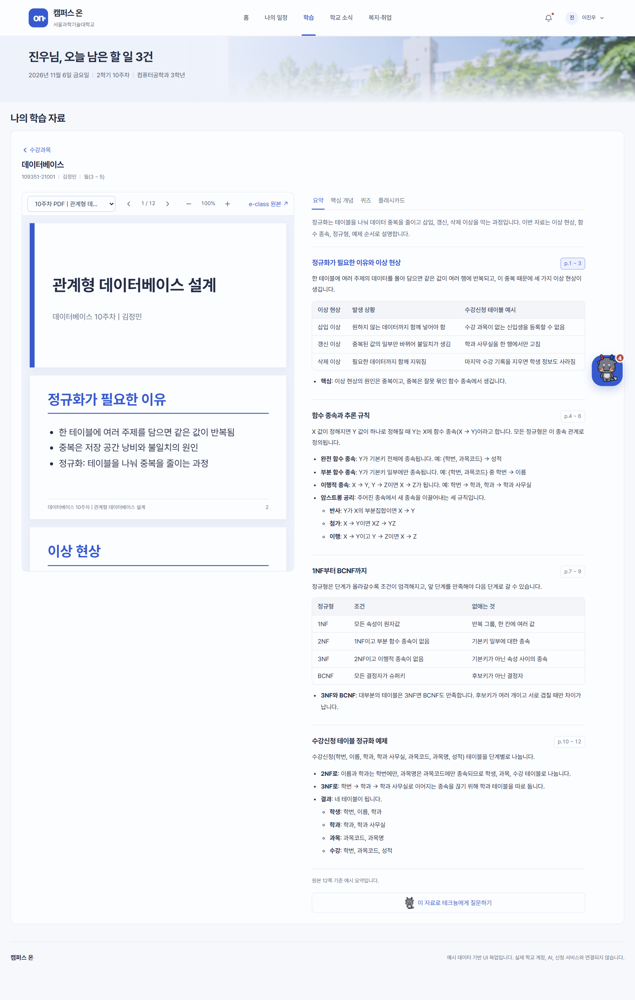
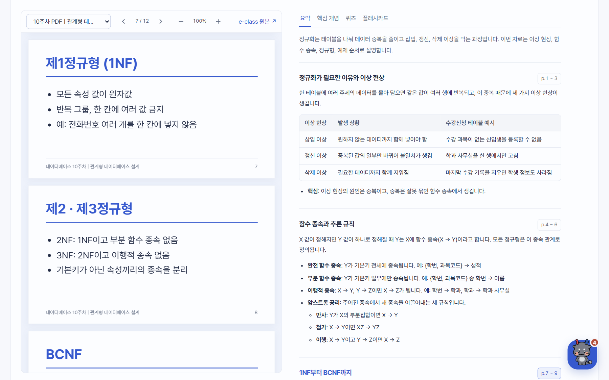
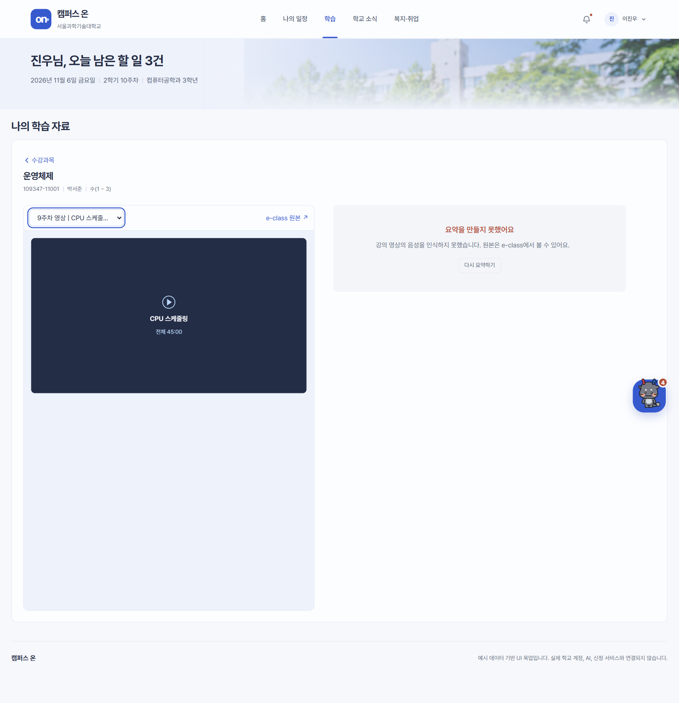
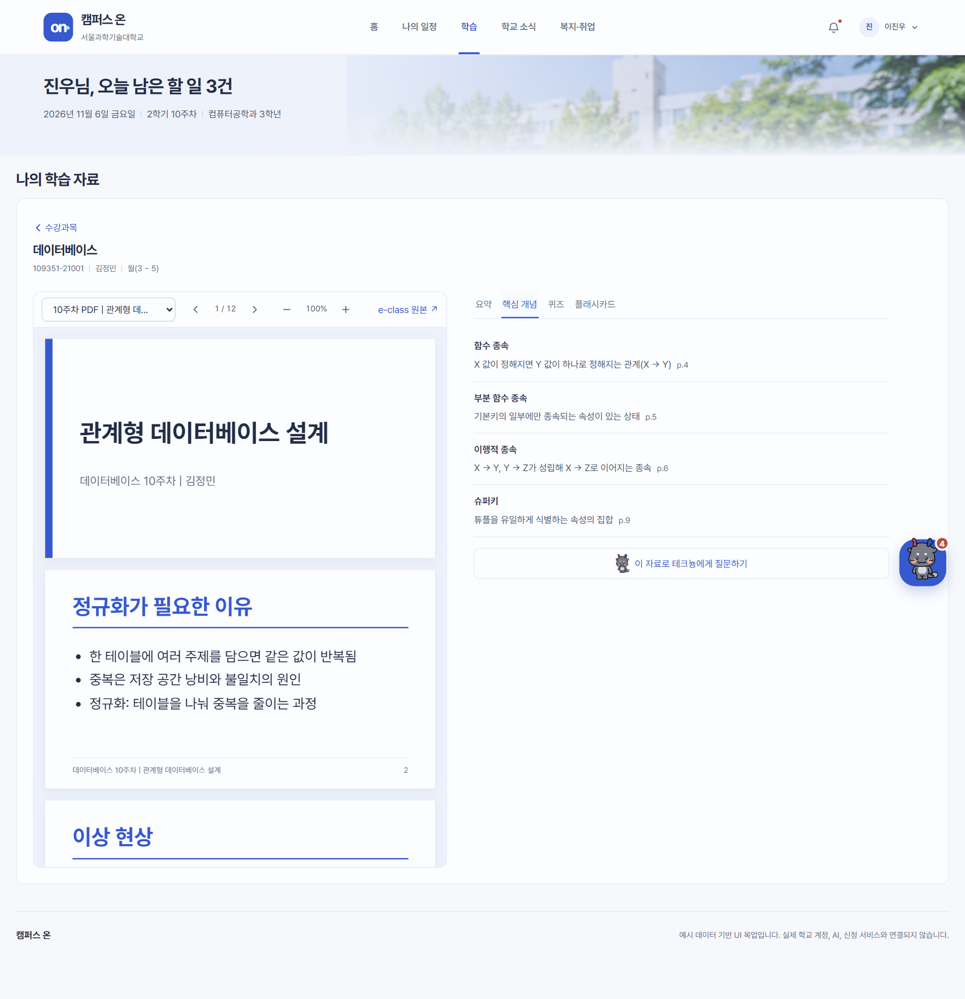
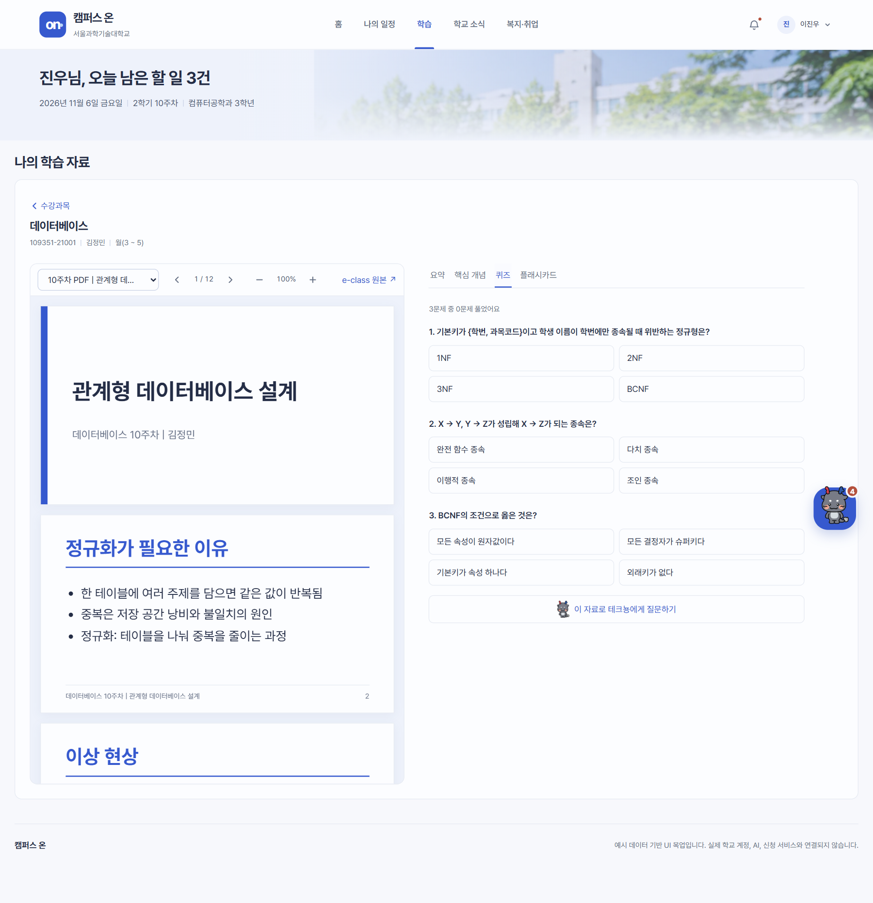
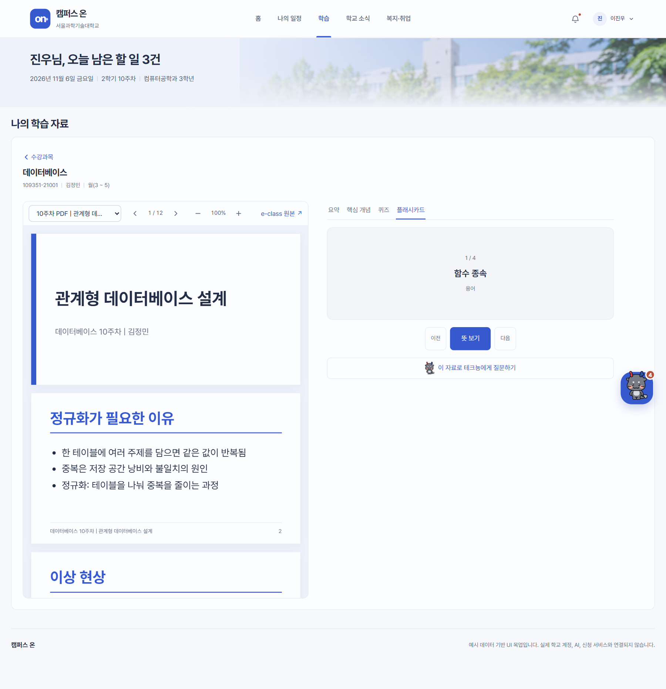
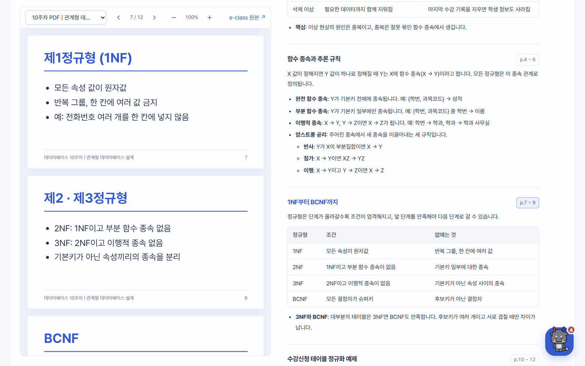
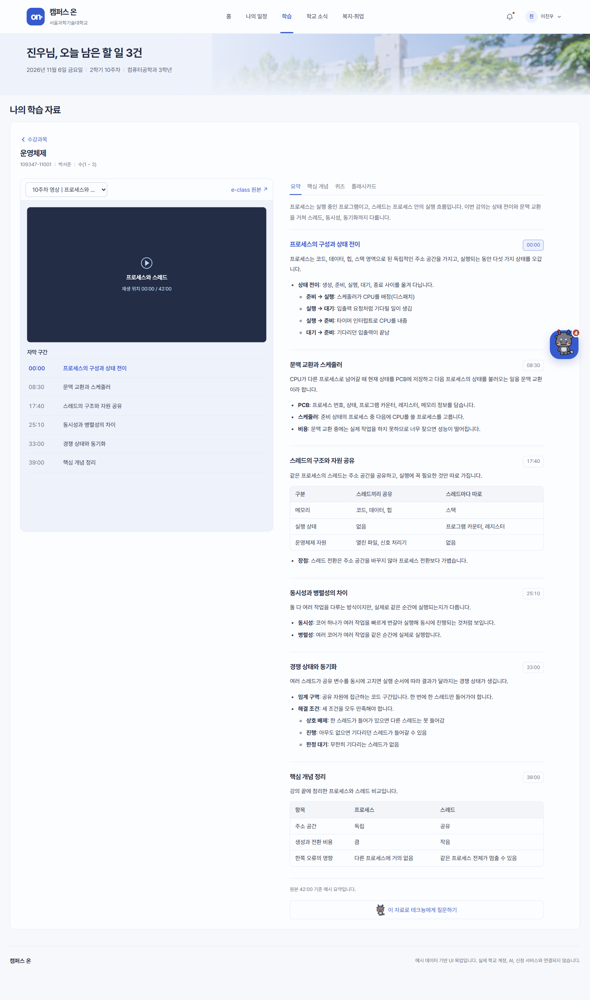
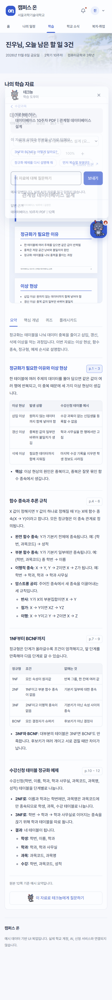

# 화면 명세 08. 학습 자료 (자료 보기 · 학습 도구) v0.1

2026-11-06 기준 목업 · 작성: 이진우 · 공통 요소: [00. 공통](00-공통.md)

## 1. 개요

과목 하나의 주차별 자료를 열어 원본 위치, 요약, 핵심 개념, 퀴즈, 플래시카드를 한 화면에서 보는 곳이다. UnivAI의 "자료 하나에서 요약·퀴즈·플래시카드 고르기"와 GPAI의 "자료를 열어둔 채 질문하기" 흐름을 가져오되, 자료는 학생이 올리지 않고 e-class에서 가져온다는 점이 다르다. 화면 모양은 두 서비스를 따르지 않고 캠퍼스 온의 토큰과 문구 원칙을 쓴다.

- **진입:** 수강과목 카드의 버튼(03) — 홈과 학습 화면 모두
- **관련 기능:** F2 e-class 연동(자료 수집), F4 학습 보조(PDF 요약, 영상 전사·요약, 문서 질의응답), F5 테크뇽 질문
- **메뉴:** 상단 메뉴는 "학습"이 선택된 채로 있고, 화면 제목은 "나의 학습 자료"다. 왼쪽 바로가기와 오른쪽 다음 수업·마감 영역을 숨기고, 본문 최대 폭 제한 없이 화면 좌우를 채운다(좌우 여백 24px).

## 2. 화면 구성

| 영역 | 내용 |
| --- | --- |
| 머리 | "수강과목" 돌아가기 버튼, 과목명, 정보 줄(학수번호 \| 교수 \| 요일(교시)) |
| 원본 보기 (왼쪽, 약 48%) | PDF 뷰어 또는 영상 재생 자리. 위에 도구 막대 |
| 학습 도구 (오른쪽, 약 52%) | 탭 4개(요약, 핵심 개념, 퀴즈, 플래시카드)와 "이 자료로 테크뇽에게 질문하기" |

원본은 서버에 복제하지 않는다는 전체 명세 8장 원칙에 따라 도구 막대에 "e-class 원본" 링크를 둔다. 목업의 PDF 쪽은 예시 슬라이드를 HTML로 그린 것이고, 실서비스에서는 PDF.js 같은 뷰어로 e-class 원본을 띄운다.

### 2.1 도구 막대

| 항목 | 내용 |
| --- | --- |
| 자료 선택 | 그 과목의 주차별 자료. 항목마다 "10주차 PDF \| 관계형 데이터베이스 설계 (요약 완료)"처럼 요약 상태를 붙임 |
| 쪽 이동 | 이전 쪽, "7 / 12", 다음 쪽. 처음·끝 쪽에서 해당 버튼 비활성 (PDF만) |
| 확대·축소 | 60%, 80%, 100%(뷰어 폭에 맞춤) 세 단계. 바꿔도 보던 쪽을 유지 (PDF만) |
| e-class 원본 | 새 탭으로 e-class를 연다 |

### 2.2 원본 보기

- **PDF:** 쪽을 세로로 이어 붙인 뷰어. 뷰어 안에서만 스크롤되고, 화면을 내려도 뷰어는 위에 붙어 있어(1200px 이상) 요약을 읽는 동안 계속 보인다. 쪽 글씨는 쪽 폭에 맞춰 커지고 작아진다.
- **영상:** 재생 자리와 "자막 구간" 목록. 구간을 누르면 재생 위치가 바뀐다(예: "재생 위치 17:40 / 42:00").
- **요약 전 PDF:** 미리보기 대신 "미리보기는 요약이 끝난 뒤 열려요" 안내.

## 3. 요약 상태

| 상태 | 자료 선택 표시 | 학습 도구 자리 |
| --- | --- | --- |
| 요약 완료 | "(요약 완료)" | 탭 4개 |
| 요약 중 | "(요약 중)" | "요약을 만드는 중이에요" 안내. 끝나면 알림으로 알림 |
| 요약 실패 | "(요약 실패)" | "요약을 만들지 못했어요"와 원인 한 줄, "다시 요약하기" 버튼 |

"다시 요약하기"를 누르면 상태가 "요약 중"으로 바뀌고 "다시 요약을 요청했어요. 끝나면 알림으로 알려드려요." 알림이 뜬다.

## 4. 학습 도구

| 탭 | 내용 | 동작 |
| --- | --- | --- |
| 요약 | 전체 흐름 한 문단, 이어서 원본 구간마다 한 덩어리씩(4.1) | 구간 오른쪽 위치 버튼으로 원본 위치 이동 |
| 핵심 개념 | 용어, 뜻, 원본 위치(p.4, 08:30 등) | 없음 |
| 퀴즈 | 객관식 3문제, 보기 4개 | 보기를 누르면 정답(초록)·고른 오답(붉은색) 표시와 해설, 원본 위치. 위에 "3문제 중 2문제 풀었어요 \| 맞힌 문제 1"과 "다시 풀기" |
| 플래시카드 | 핵심 개념의 용어를 앞면, 뜻을 뒷면으로 | "뜻 보기"/"용어 보기"로 뒤집기, "이전"·"다음"(처음·끝에서 비활성), "1 / 4" |

- 탭은 `tablist` 구조다. 좌우 화살표, Home, End로 탭을 옮긴다.
- 퀴즈·플래시카드는 실서비스에서 탭을 처음 열 때 만든다. 요약만 미리 만들어 LLM 비용을 줄인다(F4).
- 퀴즈는 한 번 고르면 그 문제의 보기를 다시 누를 수 없다. "다시 풀기"로 모두 지운다.

### 4.1 구간별 요약

요약은 원본 PDF의 쪽 범위·영상의 자막 구간과 같은 순서, 같은 수로 나눈다. 강의 자료를 넘기면서 옆에서 해설을 읽는 방식이다.

| 구성 | 내용 |
| --- | --- |
| 구간 제목 | 원본 구간 이름(예: "1NF부터 BCNF까지")과 오른쪽 위치 버튼("p.7 ~ 9") |
| 설명 | 그 구간이 무엇을 말하는지 한두 문장 |
| 표 | 비교가 있는 구간만. 예: 이상 현상 3종, 정규형 4단계, CSR과 SSR, HTTP 메서드 |
| 항목 | 굵은 용어와 설명("**부분 함수 종속**: …"), 필요하면 한 단계 아래 항목과 예시 |

- 지금 보고 있는 구간은 제목이 파랑이 되고 위치 버튼이 강조된다.
- 요약의 위치 버튼을 누르면 PDF 뷰어가 그 구간의 첫 쪽으로 스크롤된다(영상은 재생 위치가 바뀜).
- PDF 뷰어를 스크롤하면 맨 위에 보이는 쪽에 따라 쪽 번호와 강조되는 요약 구간이 바뀐다. 요약 쪽은 따라 스크롤하지 않는다.
- 영상의 자막 구간을 누르면 해당 요약 구간이 강조되고, 화면 밖에 있으면 그 구간으로 스크롤한다.
- 표는 화면이 좁으면 표 안에서 가로로 밀어 보고, 639px 이하에서는 12px 글씨로 줄인다.
- 1200px 이상에서 학습 도구 오른쪽에 64px 여백을 둔다. 오른쪽 아래 테크뇽 버튼이 위치 버튼을 가리지 않게 하기 위해서다.

## 5. 원본 위치와 쪽 범위

- PDF 구간은 쪽 범위(예: "p.4 ~ 6")로, 영상 구간은 시작 시각으로 나눈다. 쪽 번호는 핵심 개념, 퀴즈 해설, 테크뇽 답변의 근거 위치와 같은 기준이다.
- 실서비스에서는 요약을 만들 때 쪽 번호·시각을 함께 저장해야 이 연결이 된다.

## 6. 테크뇽 질문

"이 자료로 테크뇽에게 질문하기"나 오른쪽 아래 테크뇽 버튼을 누르면 테크뇽 패널이 학습 도우미로 열린다. 자세한 내용은 [06. 테크뇽 패널 5장](06-테크뇽-추천-패널.md#5-학습-도우미-모드)에 있다.

## 7. 자료 데이터 (예시 값)

| 과목 | 자료 | 길이 | 상태 | 여는 버튼 |
| --- | --- | --- | --- | --- |
| 데이터베이스 | 10주차 PDF 관계형 데이터베이스 설계 | 12쪽 | 요약 완료 | 10주차 PDF 요약 보기 |
| 데이터베이스 | 11주차 PDF 트랜잭션과 동시성 제어 | 28쪽 | 요약 중 | |
| 운영체제 | 10주차 영상 프로세스와 스레드 | 42:00 | 요약 완료 | 10주차 강의영상 요약 보기 |
| 운영체제 | 9주차 영상 CPU 스케줄링 | 45:00 | 요약 실패 | |
| 고급웹프로그래밍 | 10주차 PDF 서버 사이드 렌더링과 API 설계 | 10쪽 | 요약 완료 | 10주차 강의자료 보기 |

자료는 `app.js`의 `courses`에 있다. 자료 하나에 `outline`(위치, 제목), `pages`(PDF 쪽 제목과 줄, 표지 여부), `summary`(전체 문단과 구간별 설명·표·항목), `concepts`(용어, 뜻, 위치), `quiz`, `questions`(테크뇽 예시 질문)를 둔다. 모든 쪽·요약·문제·답변은 화면 확인용 예시다.

## 8. 반응형

| 화면 폭 | 배치 |
| --- | --- |
| 1200px 이상 | 원본 보기 \| 학습 도구 2열, 원본 보기는 화면 높이에 맞춰 위에 붙음 |
| 1199px 이하 | 1열. 원본 보기(높이 최대 640px, 화면 높이의 70%) 아래 학습 도구 |
| 767px 이하 | 좌우 여백 16px, 자료 선택이 도구 막대 한 줄을 다 씀 |
| 639px 이하 | 퀴즈 보기 1열, 요약 표 12px |

## 9. 미결 사항

- 주소가 나뉘지 않아 새로고침하면 홈으로 돌아간다. 실서비스에서는 `/learning/database/10`처럼 나눠야 한다.
- 퀴즈 생성 전에 범위 주차·문항 수·유형을 고르는 단계(GPAI의 공개형 인터랙션)는 아직 없다.
- 시험 일정(F2 강의계획서)과 이어 "시험 범위 문제 풀기"로 여러 주차 자료를 묶는 흐름은 아직 없다.
- 마인드맵, 학생이 직접 올리는 필기 사진·메모는 2차 범위로 둔다.
- 요약 품질 신고, 틀린 요약 고치기 요청 방식을 정해야 한다.
