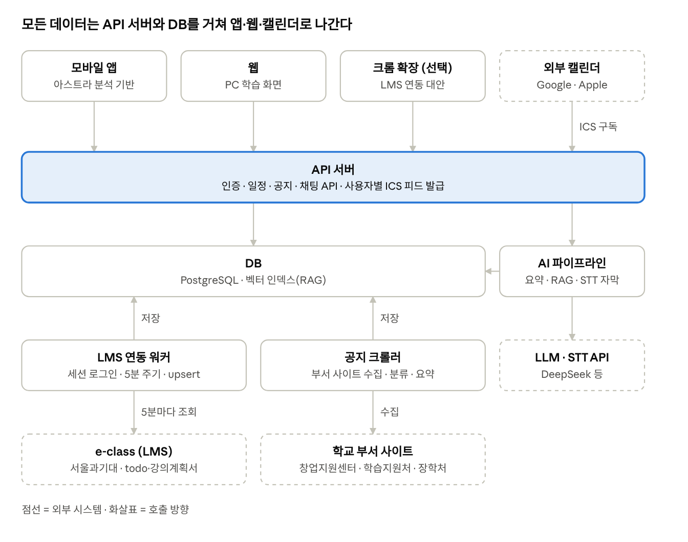

# 캠퍼스 올인원 플랫폼 구현 명세 v0.1

2026-11-06 · 작성: 이진우 · 팀 대화(오후 2:58~3:27) 기반 초안

## 1. 개요

학교 포털을 그대로 쓰면서 학술 AI를 따로 구독하지 않아도 되는, 학생용 올인원 플랫폼을 만든다. 아스트라를 대체하거나 업그레이드하는 앱이고, 일정관리 서비스 Planary는 별도 앱이 아니라 그 안의 서브 시스템으로 들어간다.

- **서비스명:** 미정 (가칭: 캠퍼스 올인원)
- **타깃:** 1차 서울과기대 재학생, 2차 타 대학 (에브리타임식 확장)
- **캐릭터:** 테크뇽을 AI 어시스턴트 캐릭터로 활용

**포지셔닝 / 차별점**

| 비교 대상 | 한계 | 우리 서비스 |
| --- | --- | --- |
| 아스트라 | 소셜·간편 로그인 없음, 캘린더는 파일을 받아 직접 넣어야 함, 버그 많음 | 계정 연동 후 캘린더 자동 동기화, 페인포인트 전면 개선 |
| Univ AI, GPAI | 학술 AI 유료 구독, 학교 자료를 사용자가 직접 올려야 함 | 학교 자료를 미리 요약해 제공하고, 추가 질문만 AI에게 물음 |
| 학교 각 부서 사이트 | 창업지원센터·학습지원처·장학처 등 공지가 흩어져 있음 | 공지·복지·행사를 한 화면에 모으고 학년별로 추천 |

한 줄 메시지: "학교 포털은 그대로, 학술 AI 구독은 필요 없이."

## 2. 범위

MVP는 서울과기대 기준으로 일정관리 + 학습 보조 + AI 어시스턴트까지 만든다. 커뮤니티·생활 기능과 타 학교 이식은 이후 단계다.

| 단계 | 포함 기능 |
| --- | --- |
| MVP (서울과기대) | 계정·로그인, e-class 연동, Planary 일정관리, 외부 캘린더 자동 동기화, PDF 학습 보조, 강의 영상 요약·전사·자막, AI 어시스턴트(말풍선), 학교 공지 통합 |
| 2차 확장 | 커뮤니티, 교내 중고장터, 학교 메일 연동, 기자재 대여 |
| 3차 확장 | 타 대학 이식 (학교별 어댑터 구조) |

MVP 단계부터 학교 종속 로직(LMS 주소, 공지 사이트 목록, 크롤러)은 `school_id` 기준 어댑터로 분리해 두어야 3차 이식 비용이 줄어든다.

## 3. 기능 명세 (MVP)

MVP 기능은 F1~F6 여섯 개이고, F2(e-class 연동)가 나머지 대부분의 데이터 원천이다.

### F1. 계정 · 로그인

- Google 소셜 로그인, 간편 로그인 지원 (아스트라에 없는 기능)
- 로그인 후 학교 계정 연동 단계를 별도로 진행 (F2)
- 프로필: 학교, 학과, 학년 — F5 맞춤 추천에 사용

### F2. e-class(LMS) 연동

- 가져올 데이터: 미완료 과제, 온라인 강의, 과목 공지사항, 강의 자료(PDF·영상)
- 연동 방식: Planary의 세션 방식(학번·비밀번호 로그인, 암호화 저장) — 4장 참고
- 동기화 주기: 5분 (백업 cron 6시간, 수동 동기화 버튼)

### F3. Planary 일정관리

- F2에서 받은 과제·강의·시험 일정을 하나의 캘린더·할 일 목록으로 표시
- 사용자 개인 일정 추가·수정, 완료 체크
- 마감 임박 알림 (푸시)
- Google 캘린더·Apple 캘린더 자동 동기화: 사용자별 구독용 ICS URL을 발급해 한 번만 등록하면 이후 자동 갱신 (파일 다운로드 방식 대체)

### F4. 학습 보조

- **PDF:** 강의·과제 PDF 요약을 미리 생성해 제공, 문서 기반 질의응답(RAG)
- **영상:** 강의 영상 전사(STT) → 요약 + 자막 파일 생성·재생 시 표시
- 사용자가 추가로 궁금한 것만 질문하는 흐름 (자료는 이미 컨텍스트에 있음)

### F5. AI 어시스턴트 (테크뇽 말풍선)

- 화면 우측 하단 플로팅 말풍선, 누르면 크롬의 Gemini 창처럼 바로 대화창이 열림
- 능동 요약: 현재 학년에 맞는 복지 혜택, 장학금, 취업 설명회 등을 말풍선으로 알림
- 수동 질문: 내 일정, 과제, 학교 공지, 강의 자료에 대해 자연어로 질문

### F6. 학교 공지 통합

- 수집 대상: 학교 공지, 창업지원센터, 학습지원처, 장학처 등 부서별 사이트
- 카테고리 분류(장학/취업/행사/학사)와 LLM 한 줄 요약
- 대상 학년·학과 태깅 → F5 추천의 입력

## 4. e-class 연동 전략

e-class 연동은 [Planary](https://github.com/yoobinkim541/plannary_smart_planner)에 구현된 세션 방식을 그대로 가져온다. iCal 구독과 공식 제휴는 세션 방식이 막혔을 때 쓸 대안으로 둔다.

**연동 흐름 (Planary `api/eclass/*`, `worker/` 기준)**

1. 사용자가 e-class 학번·비밀번호를 입력하면, 서버가 `eclass.seoultech.ac.kr/ilos/index.acl`에 로그인해 검증한다.
2. 검증에 성공하면 학번·비밀번호·세션 쿠키를 AES-256-GCM으로 암호화해 사용자별 연동 레코드에 저장한다. 같은 계정의 중복 연동은 baseUrl+학번 해시(`credentialKey`)로 막는다.
3. 상주 워커가 5분마다 연동된 사용자 전체를 동기화한다. 세션 쿠키로 todo 페이지 HTML을 받아 파싱하고, 쿠키가 만료되면 저장된 자격증명으로 다시 로그인한다.
4. 가져오는 것: 과제·퀴즈·영상 강의(마감일·시각·D-day), 수강 과목 목록, 강의계획서(HTML/PDF)에서 추출한 중간·기말·발표·프로젝트 일정.
5. `source:sourceItemId` 키로 upsert하고, e-class에서 사라진 항목은 정리한다.
6. 백업 경로: 6시간마다 도는 외부 cron이 `/api/eclass/sync`를 호출(`CRON_SECRET` 인증)하고, 앱에는 수동 동기화 버튼을 둔다.
7. 연동을 해제하면 암호화된 자격증명과 쿠키를 즉시 삭제한다.

**이식할 때 바꿔야 할 것**

| 항목 | Planary | 우리 서비스 |
| --- | --- | --- |
| 저장소 | Firestore (`eclass_connections`, `todos`) | PostgreSQL (`LmsLink`, `Event`) |
| 실행 환경 | Vercel 함수 + Ubuntu 상주 워커 | API 서버 + LMS 연동 워커 |
| 수집 범위 | 할 일(과제·퀴즈·영상), 수강 과목, 강의계획서 시험 일정 | 같음 + 과목 공지사항·강의 자료(PDF·영상) 추가 구현 |
| 암호화 키 | `ECLASS_ENCRYPTION_KEY` (없으면 `CRON_SECRET`으로 대체) | 전용 키만 사용, 다른 키로 대체하지 않음 |

과목 공지사항과 강의 자료 수집은 이번에 확인한 Planary 코드(`_seoultech.js`, `sync-core.js`)에서는 보이지 않았다. 이미 구현돼 있는지 김유빈에게 확인이 필요하다.

**대안 (세션 방식이 막혔을 때)**

| 방식 | 가져올 수 있는 것 | 한계 |
| --- | --- | --- |
| iCal(ICS) 구독: e-class 캘린더 내보내기 링크를 1시간마다 폴링 | 마감 일정 | 공지·자료 불가, 서울과기대 지원 여부 미확인 |
| 공식 제휴 (아스트라·LMS 측 협력 메일) | 전체 | 회신까지 시간이 걸리고 거절될 수 있음 |
| 크롬 확장 프로그램 | 화면에 보이는 것 전부 | 모바일 미지원 |
| LMS 벤더사에 기능 제안 | 협의 범위 | MVP 일정 안에 어려움 |

운영 규칙: 연동 커넥터는 공통 인터페이스(`fetchEvents`, `fetchNotices`, `fetchMaterials`) 뒤에 두어, 방식을 바꿔도 F3~F6은 수정하지 않는다.

## 5. 시스템 아키텍처 · 기술 스택 제안

앱·웹은 API 서버 하나만 호출하고, LMS 연동·공지 수집·AI 처리는 별도 워커로 분리한다. 학교가 바뀌면 워커의 어댑터만 교체한다.

외부 캘린더는 API 서버가 발급한 사용자별 ICS URL을 주기적으로 가져가고, 워커 결과는 모두 DB에 저장된다.

| 영역 | 제안 (팀 확정 필요) |
| --- | --- |
| 앱 | React Native 또는 Flutter, 아스트라 APK 분석 자료 기반 화면 구성 |
| 웹 | Next.js |
| API 서버 | Spring Boot 또는 NestJS |
| DB | PostgreSQL + pgvector |
| 워커 · 스케줄러 | 상주 워커(5분 주기) + 백업 cron(6시간) |
| LLM | DeepSeek API, 프로바이더 추상화 레이어 |
| STT | Whisper 계열 |
| 푸시 알림 | FCM |

## 6. 데이터 모델 초안

ERD는 김유빈이 담당한다(DB 텀프로젝트 겸용). 아래는 기능 명세에서 나온 핵심 엔터티 출발점이다.

| 엔터티 | 주요 필드 | 관계 |
| --- | --- | --- |
| School | id, name, lms_base_url, notice_sources | 1:N User, Course, Notice |
| User | id, school_id, email, oauth_provider, department, grade | N:1 School |
| LmsLink | id, user_id, base_url, credential_key, enc_username, enc_password, enc_session_cookie, last_synced_at, last_error | N:1 User |
| Course | id, school_id, lms_course_id, name, professor | N:M User (Enrollment) |
| Event | id, user_id, course_id, type(assignment/lecture/exam/personal), title, due_at, source, external_uid, done | N:1 User, Course |
| Material | id, course_id, kind(pdf/video), url, summary, transcript, subtitle_url | N:1 Course |
| Notice | id, school_id, source(부서), category, title, url, summary, target_grade, posted_at | N:1 School |
| ChatMessage | id, user_id, role, content, context_refs, created_at | N:1 User |
| CalendarFeed | id, user_id, token | 1:1 User (F3 외부 구독용) |

`Event.external_uid`는 e-class 항목 키(과목코드:구분:항목ID)를 저장해 5분 동기화 때 중복 없이 upsert하는 키로 쓴다.

## 7. 리스크 · 컴플라이언스

가장 큰 리스크는 서버가 학교 계정 비밀번호를 보관하는 세션 연동 방식 자체다. Planary의 암호화·삭제 정책을 그대로 따르고, 학교 측에 사전 문의해 두는 것을 권장한다.

| 리스크 | 내용 | 대응 |
| --- | --- | --- |
| 학교 시스템 비공식 접근 | 아스트라 APK 분석, 학교 백엔드 직접 호출은 약관·정보통신망법 문제가 될 수 있고, 대회에서 감점·실격 사유가 될 수 있음 | APK 분석은 UI·기능 참고 수준으로 한정, e-class는 사용자 본인 계정으로 웹 페이지를 읽는 Planary 방식만 사용, 비공개 API 탐색은 하지 않음, 학교 정보화팀에 사전 문의 |
| 학교 계정 비밀번호 보관 | 유출 시 포털·메일 등 학교 계정 전체 노출 | AES-256-GCM 암호화 저장, 키는 서버 환경변수로만 관리, 연동 시 명시적 동의, 해제 시 즉시 삭제 |
| 개인정보 | 학번·수강 과목·일정 처리 | 개인정보 처리방침, 최소 수집, 탈퇴 시 삭제 |
| 강의 자료 저작권 | 교수 자료·영상을 서버에 복제·가공 | 원본은 저장하지 않고 요약·자막은 본인에게만 노출 |
| LLM 비용·데이터 전송 | DeepSeek 등 해외 API에 학생 데이터 전송 | 프로바이더 추상화 레이어로 교체 가능하게, 개인식별정보는 제거 후 전송 |
| 크롤링 차단 | 부서 사이트 구조 변경·차단 | robots.txt 준수, 저빈도 수집, RSS가 있으면 RSS 우선 |

e-class 화면 구조가 바뀌면 HTML 파서가 깨진다. Planary의 파서 테스트(`parser.test.js`)를 함께 이식하고, 동기화 실패는 `LmsLink.last_error`에 남긴다. 5분 주기는 사용자가 늘면 학교 서버에 부하가 되므로 규모에 맞춰 조정한다.

## 8. 수익 모델

기본 기능은 무료로 두고, AI 사용량에 따라 광고를 노출해 LLM 비용을 충당한다. DeepSeek 같은 저렴한 모델을 쓰면 사용자당 비용을 광고 수익 아래로 맞출 수 있다는 가정이며, 사용자당 토큰 비용 추정은 아직 없다.

## 9. 역할 분담 · 액션 아이템 · 미결 사항

**액션 아이템**

- [ ] Planary e-class 연동 모듈 이식 범위 정리 (과목 공지·강의 자료 수집 포함 여부) — 김유빈
- [ ] 아스트라 APK 분석 결과(GitHub 정리본)를 바탕으로 앱 화면 설계 — 김유빈
- [ ] DB ERD 작성 — 김유빈
- [ ] 기획 완료 후 아스트라 측에 협력 메일 발송 — 담당 미정
- [ ] 영상 요약·전사·자막, 학교 공지 통합 기능 상세화 — 양하정 (제안자)

**미결 사항**

- 서비스명은 무엇으로 할지
- Univ AI·GPAI 대비 차별점을 더 구체화할지 (현재: 학교 자료 자동 제공 + 올인원 + 무료)
- LLM 프로바이더 확정 (DeepSeek 후보) 및 STT 엔진 선택
- 앱(네이티브/크로스플랫폼)과 웹 중 MVP 우선 플랫폼
- 테크뇽 캐릭터 사용 시 학교 측 사용 허가가 필요한지
- 대화 중 공유된 사진 3장의 내용은 이 문서에 반영되지 않음 (텍스트만 받음)

## 10. 인터랙티브 화면 목업

- 실행: 같은 폴더의 `index.html`을 브라우저에서 연다. 설치나 빌드 없이 확인할 수 있다.
- 화면별 명세: [`docs/screens/`](docs/screens/00-공통.md)에 공통 요소, 홈, 나의 일정, 학습, 학교 소식, 복지·취업, 테크뇽 패널, 대화상자, 학습 자료 명세를 화면 캡처와 함께 나눠 두었다.
- 구성: 가칭 **캠퍼스 온**. 밝은 배경·상단 메뉴·낮은 캠퍼스 사진 띠(날짜·주차, 오늘 남은 할 일 수)를 사용하고, 요약 숫자 → Planary 오늘 할 일·다음 수업(이번 주 시간표 포함) → 수강과목 카드 → 학교 소식 → 신청 가능한 프로그램 순으로 배치했다.
- 수강과목 카드는 e-class 과목 카드 구조를 따른다: 배경 위 과목명·학수번호·교수, 요일(교시)·학점, 진행 주차 막대, 참여·출석 수치, 이번 주 자료 버튼. 학수번호·교수·교시·참여·출석은 예시 값이다. 배경은 과목별 단색(파랑, 청록, 자주)이고 강조색 파랑과 겹치지 않게 골랐다.
- 학습 자료 화면(F4): 자료 버튼을 누르면 주차별 자료 목록, 원본 위치(PDF 쪽·영상 자막 구간), 요약·핵심 개념·퀴즈·플래시카드 탭을 한 화면에 보여준다. 요약은 원본 구간과 같은 순서로 나눠 구간마다 설명, 비교 표, 굵은 용어 항목을 붙이고, 요약 구간과 원본 위치가 서로 따라 움직인다. Univ AI·GPAI의 "자료 하나에서 학습 도구 고르기"와 "자료를 열어둔 채 질문하기" 흐름을 참고했고, 자료는 e-class에서 가져온다. 이 화면에서 테크뇽을 열면 지금 보는 자료를 근거로 답하는 학습 도우미가 된다. 자료마다 요약 완료·요약 중·요약 실패 상태를 표시한다.
- 문구 원칙: 슬로건·응원 문구·영문 소제목·장식 화살표 없이 날짜, 마감, 장소 같은 사실만 쓴다. 제목 위 작은 분류 문구를 두지 않고, 분류는 제목 아래 정보 줄로 옮긴다. 정보 줄은 가운뎃점 대신 세로 구분선으로 나누며, 버튼 문구는 "모집 내용 보기"처럼 동작으로 쓴다. 보조 글씨는 12px 이상, 회색 글씨는 `--color-muted`(#667085)로 흰 배경 대비 4.5:1 이상을 맞춘다. 강조색은 파랑 하나, 빨강 계열은 마감 표시와 안 읽은 알림 수에만 쓴다.
- 디자인 토큰: 색·글꼴·글자 크기(1.2배 단계)·간격(4px 단위)·모서리·그림자·움직임 시간은 `tokens.css`에 모으고, 공통 기본값은 `base.css`, 화면별 규칙은 `styles.css`에 둔다. `styles.css`에는 색이나 글꼴 값을 직접 쓰지 않는다. 이 정리는 Hallmark 디자인 규칙 검사(`sloplint`)를 기준으로 했다.
- `index.html`은 화면 구조, `styles.css`는 반응형 레이아웃과 애니메이션, `app.js`는 예시 데이터와 브라우저 내 상호작용을 담당한다.
- 동작: 홈·일정·학습·학교 소식·복지취업 메뉴 전환, 주·날짜 선택, 오늘 복귀, 일정 완료·취소, 개인 일정 추가, 공지 분류 필터, 자료·공지·추천 상세보기, 알림·프로필 팝오버.
- 우측 하단 테크뇽 FAB는 등장·호버·패널 열기/닫기 애니메이션을 제공한다. 추천 4건의 상세보기를 지원하며 Escape로 닫고 FAB로 포커스를 돌려준다. 동작 줄이기 설정에서는 애니메이션을 생략한다.
- 모바일에서는 콘텐츠를 세로로 배치하고 FAB 패널을 화면 안에 맞춰 스크롤할 수 있게 한다. 상세보기와 일정 추가는 브라우저의 모달 대화상자를 사용한다.
- 일정 추가·완료 상태는 메모리에만 유지되며 새로고침하면 초기화된다. 예시 기준일은 2026년 11월 6일이다.
- 실제 학교 로그인·API·AI 응답·수강·프로그램 신청·캘린더 동기화 기능은 연결하지 않는다. 모든 안내와 요약은 예시이며 실제 공고로 사용하면 안 된다.
- `assets/campus.webp`는 제공된 포털 이미지의 캠퍼스 사진 부분, `assets/technyong-front.webp`는 학교 공식 캐릭터 시트의 정면 포즈에서 배경만 분리한 것이고, `technyong-hearts.webp`(하트)와 `technyong-cheer.webp`(응원)는 제공된 공식 이모티콘이다. 내부 화면 검토용 자산으로 사용한다.
- 테크뇽 사용 규칙: 공식 그림을 색·필터·부분 자르기 없이 그대로 쓰고, 뒤에 장식 배경을 깔지 않는다. 정면 포즈는 테크뇽 버튼·패널 머리와 일정이 없는 날의 빈 화면에, 하트 표정은 추천 패널 첫 인사에, 응원 표정은 선택한 날의 할 일을 모두 끝냈을 때 목록 맨 위에 쓴다. 축하 알림창은 띄우지 않는다.
- 폰트는 e-class의 `base.css`와 `pretendard-jp.css`에서 확인한 **Pretendard JP**를 사용한다. 실제로 쓰는 400·600·700 굵기의 WOFF2 파일만 `assets/fonts/`에 포함해 외부 접속 없이 로딩하며, SIL OFL 라이선스를 함께 보관한다.
